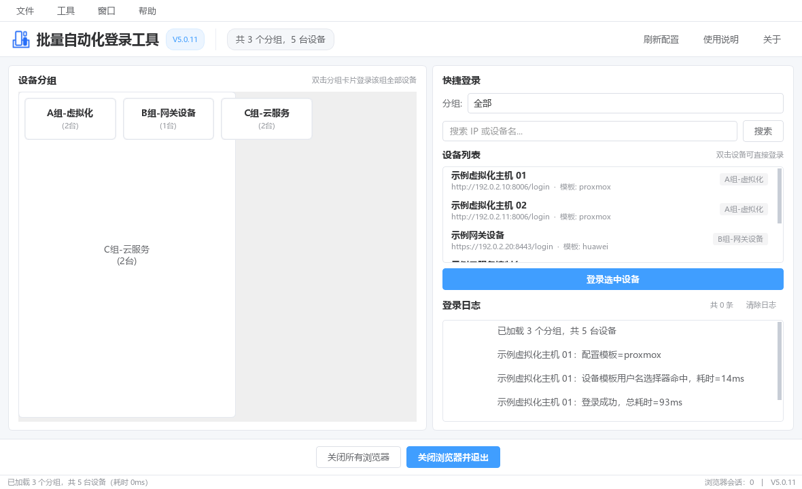

<div align="center">
  
  <br><br>
  <b>Batch Auto Login</b><br>
  Import one spreadsheet, log in to dozens of device web consoles at once
</div>

<div align="center">

[](https://www.python.org/)
[](https://pypi.org/project/PyQt6/)
[](https://playwright.dev/python/)
[](LICENSE)
[](docs/测试报告.md)

</div>

<div align="center">

[中文](README.md) · [Docs](docs/README.md) · [User Guide](docs/使用说明.md) ·
[Changelog](CHANGELOG.md) · [Contributing](CONTRIBUTING.md)

</div>

---

## What is this?

A Windows desktop tool for **operations / device management** teams: import a spreadsheet of
devices, group them, and **log in to many web consoles at once**.

- Every admin console has a different form — the tool **recognises** the username,
  password, captcha and submit roles from semantic evidence;
- **Captcha OCR** for 4-character digit + letter images (case-sensitive), with a manual
  fallback at any time;
- Credentials are **encrypted on disk** — no plaintext passwords lying around;
- Success is decided by the **real page state**, not by "the button was clicked".

> Automation core: Playwright (Chromium, **headed**). The browser stays visible so you
> can take over at any moment.

---

## Quick start

```bat
pip install -r requirements.txt
set PLAYWRIGHT_BROWSERS_PATH=0
playwright install chromium
python main.py
```

First run:

1. **File → Create Excel template**;
2. Fill in your devices in Excel;
3. **File → Import from Excel**;
4. **Double-click a group card** — every device in that group starts logging in.

The spreadsheet has 6 columns:

| Device name | Login URL | Username | Password | Group | Template |
|-------------|-----------|----------|----------|-------|----------|
| Device A | http://192.0.2.10:8080/login | demo_user | demo_password | Group A | default |

Only the login URL is required; the template column may be left empty
(empty = generic smart recognition).

---

## Highlights

| Area | Capability |
|------|------------|
| **Batch login** | Double-click a group card to log in the whole group; one isolated browser window per group |
| **Form recognition** | Four roles graded by semantic evidence, with per-candidate diagnostics on failure |
| **Captcha** | Recognise → fill → submit, auto-refresh on failure; case-sensitive; can be switched off |
| **Templates** | Plain-text `templates/*.json`; record, append, merge or replace — your hand edits are never overwritten |
| **Credential safety** | PBKDF2 encryption, atomic writes, no corrupted config after a failed import |
| **Responsive UI** | Import and login run in background threads; the window never freezes |
| **Distribution** | One-file PyInstaller EXE — the target machine needs no Python, browser or ChromeDriver |

---

## Build a single-file EXE

```bat
build.bat
```

Output: `dist/批量登录工具V6.0.6.exe` (Windows path `dist\批量登录工具V6.0.6.exe`), ready to
double-click.

---

## FAQ

| Symptom | Fix |
|---------|-----|
| Chromium not found | `set PLAYWRIGHT_BROWSERS_PATH=0` then `playwright install chromium` |
| First EXE launch is slow | It unpacks the bundled browser (hundreds of MB) — expected |
| "Form not found" | Re-record the selectors via **Tools → Save login template** |
| Cannot decrypt on a new PC | The key is machine-bound — re-import the Excel file |
| HTTPS certificate warning | Certificate ignoring is built in; the tool also tries "Advanced → Continue" |

More: [`docs/使用说明.md`](docs/使用说明.md).

---

## Documentation

| Document | Contents |
|----------|----------|
| [`docs/README.md`](docs/README.md) | Documentation index |
| [`docs/使用说明.md`](docs/使用说明.md) | Install, spreadsheet format, menus, captcha, FAQ |
| [`docs/功能与实现详解.md`](docs/功能与实现详解.md) | How each feature is implemented, diagnostics, performance data |
| [`docs/技术文档.md`](docs/技术文档.md) | Architecture, threading, locator algorithms, packaging |
| [`docs/模板维护说明.md`](docs/模板维护说明.md) | Login template format and maintenance |
| [`docs/验证码自动识别说明.md`](docs/验证码自动识别说明.md) | Captcha OCR settings and tuning |
| [`docs/测试报告.md`](docs/测试报告.md) | Real test execution results |
| [`CHANGELOG.md`](CHANGELOG.md) | Full changelog |

---

## Contributing

Issues and pull requests are welcome — please read [`CONTRIBUTING.md`](CONTRIBUTING.md) first.

## License

[Apache License 2.0](LICENSE)

```
Copyright 2026 Jonathon
```

---

**Version**: 6.0.6 · **Author**: Jonathon · **Single source of truth for the version**:
`APP_VERSION` in `appcore/config.py` · Next release defaults to 6.0.7