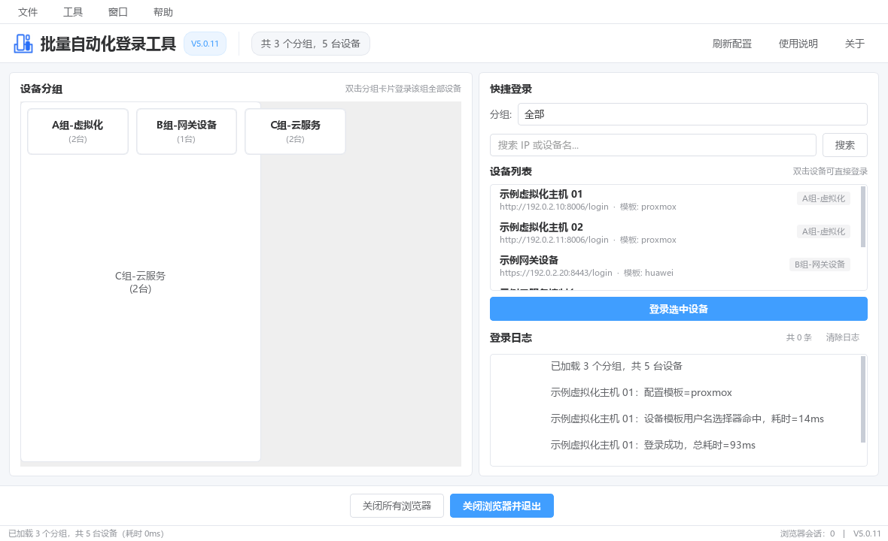

<div align="center">
  
  <br><br>
  <b>批量自动化登录工具</b><br>
  导入一张 Excel，批量登录几十台设备的 Web 管理后台
</div>

<div align="center">

[](https://www.python.org/)
[](https://pypi.org/project/PyQt6/)
[](https://playwright.dev/python/)
[](LICENSE)
[](docs/测试报告.md)

</div>

<div align="center">

[English](README.en.md) · [文档中心](docs/README.md) · [使用说明](docs/使用说明.md) ·
[更新日志](CHANGELOG.md) · [贡献指南](CONTRIBUTING.md)

</div>

---

## 这是什么？

面向**运维 / 设备管理**团队的 Windows 桌面工具：把一份 Excel 设备表导入程序，
按分组**一键批量登录**一批设备的 Web 管理后台。

- 每台设备的后台表单结构都不一样 —— 程序**智能识别**用户名 / 密码 / 验证码 / 登录按钮；
- **验证码自动识别**（4 位数字 + 大小写字母图片验证码，区分大小写），也可随时退回人工输入；
- 账号密码**加密落盘**，不在硬盘上留明文；
- 登录成功与否由**页面真实状态**判定，不是「点了提交就算成功」。

> 自动化内核：Playwright（Chromium，**有头模式**）。浏览器保持可见，可随时人工接管。

---

## 快速开始

> **环境**：Python 3.14.10
>
> **快捷安装**：`winget install -e --id Python.Python.3.14`

```bat
pip install -r requirements.txt
set PLAYWRIGHT_BROWSERS_PATH=0
playwright install chromium
python main.py
```

首次使用：

1. 菜单 **文件 → 创建Excel模板**；
2. 在 Excel 里填好设备信息；
3. 菜单 **文件 → 从Excel导入**；
4. **双击左侧分组卡片** —— 该组设备开始批量登录。

Excel 模板共 6 列：

| 设备名称  | 登录地址(URL)                | 用户名    | 密码          | 分组 | 模板    |
| --------- | ---------------------------- | --------- | ------------- | ---- | ------- |
| 示例设备A | http://192.0.2.10:8080/login | demo_user | demo_password | A组  | default |

「登录地址」是唯一必需列；「模板」可留空（留空 = 通用智能识别）。

---

## 主要功能

| 分类         | 能力                                                                                |
| ------------ | ----------------------------------------------------------------------------------- |
| **批量登录** | 分组卡片双击即登录整组；每组一个独立浏览器窗口，会话互不污染                        |
| **表单识别** | 用户名 / 密码 / 验证码 / 登录按钮四类角色，按语义证据分级判定，失败时给出逐候选诊断 |
| **验证码**   | 自动识别 → 填写 → 提交，失败自动刷新重试；区分大小写；可一键关闭退回人工            |
| **登录模板** | `templates/*.json` 纯文本，可录制、追加、合并、替换，程序不会覆盖你手工维护的内容   |
| **凭据安全** | PBKDF2 加密 + 原子写盘，导入失败不损坏配置                                          |
| **界面体验** | 导入与登录全部后台化，界面全程可点；分组卡片、进度条、失败原因一目了然              |
| **打包发布** | PyInstaller 单文件 EXE，目标机器无需装 Python、浏览器或 ChromeDriver                |

---

## 打包成单文件 EXE

```bat
build.bat
```

产物：`dist/批量登录工具V6.0.6.exe`（Windows 路径 `dist\批量登录工具V6.0.6.exe`），
双击即可运行。

**打包参数说明：**

> - **build.bat**          : 使用当前版本号打包（默认；重复打包不改变版本号）
>
> - **build.bat bump**     : 先把补丁号 +1（5.0.9 -> 5.0.10），再打包
>
> - **build.bat 5.0.10**   : 先切换到指定版本号，再打包

## 常见问题

| 现象                   | 处理                                                              |
| ---------------------- | ----------------------------------------------------------------- |
| 找不到 Chromium        | `set PLAYWRIGHT_BROWSERS_PATH=0` 后 `playwright install chromium` |
| EXE 首次启动慢         | 正在解压内置浏览器（数百 MB），属正常现象                         |
| 提示「Form not found」 | 用 **工具 → 保存登录模板** 重新录制选择器                         |
| 切换电脑后无法解密     | 加密密钥与机器相关，重新导入 Excel 即可                           |
| HTTPS 证书告警         | 程序已内置忽略策略，并会尝试点击「高级 → 继续」                   |

更多问题见 [`docs/使用说明.md`](docs/使用说明.md)。

---

## 文档

| 文档                                                       | 内容                                     |
| ---------------------------------------------------------- | ---------------------------------------- |
| [`docs/README.md`](docs/README.md)                         | 文档总目录                               |
| [`docs/使用说明.md`](docs/使用说明.md)                     | 安装、Excel 模板、菜单、验证码、常见问题 |
| [`docs/功能与实现详解.md`](docs/功能与实现详解.md)         | 功能实现原理、诊断日志、性能数据         |
| [`docs/技术文档.md`](docs/技术文档.md)                     | 架构、线程模型、定位算法、打包流程       |
| [`docs/模板维护说明.md`](docs/模板维护说明.md)             | 登录模板格式与维护指引                   |
| [`docs/验证码自动识别说明.md`](docs/验证码自动识别说明.md) | 验证码自动识别参数与调参建议             |
| [`docs/测试报告.md`](docs/测试报告.md)                     | 真实测试执行结果                         |
| [`CHANGELOG.md`](CHANGELOG.md)                             | 完整更新日志                             |

---

## 贡献

欢迎提交 Issue 与 PR，请先阅读 [`CONTRIBUTING.md`](CONTRIBUTING.md)。

## 许可证

[Apache License 2.0](LICENSE)

```
Copyright 2026 Jonathon
```

---

**版本**：6.0.6　|　**作者**：Jonathon　|　**版本号唯一来源**：`appcore/config.py` 的 `APP_VERSION`　|　下一次正式发布默认递增为 6.0.7