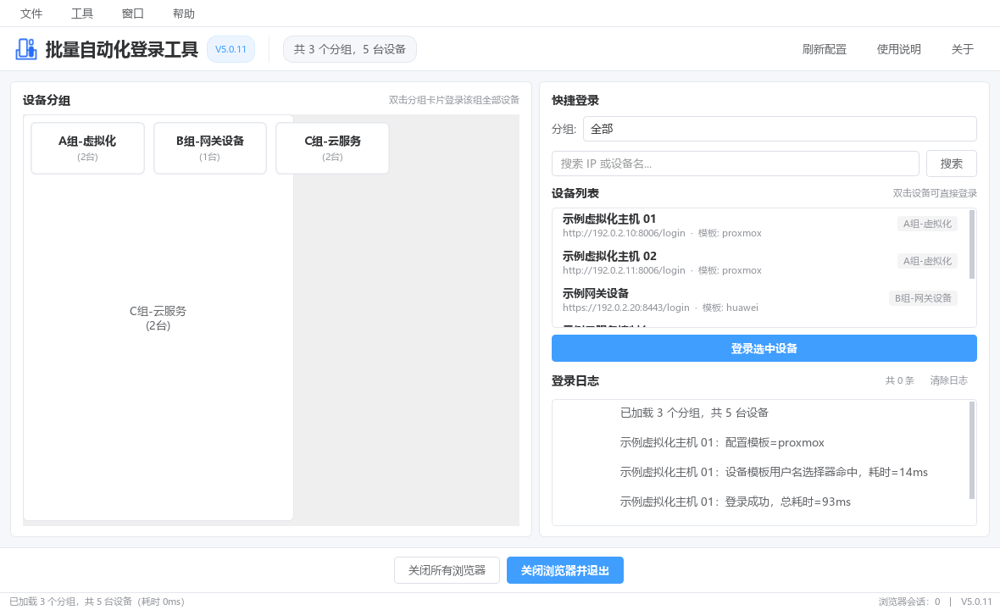

<div align="center">
  
  <br><br>
  <b>批量自动化登录工具</b><br>
  多设备分组批量 Web 登录 · 智能表单识别 · 可维护登录模板
</div>


<div align="center">

[](https://www.python.org/)
[](https://pypi.org/project/PyQt6/)
[](https://playwright.dev/python/)
[](https://pypi.org/project/openpyxl/)
[](LICENSE)
[](#-测试)

</div>

<div align="center">
[English](README.en.md) · [更新日志](CHANGELOG.md) · [贡献指南](CONTRIBUTING.md) ·
[项目介绍](docs/项目介绍.md)

</div>

---

## 这是什么

一个面向 **运维 / 设备管理** 场景的 Windows 桌面工具：把一份 Excel 设备表导入程序，
按分组**一键批量登录**一堆设备的 Web 管理后台。

它解决的不是「怎么点一次登录按钮」，而是这些真实痛点：

- 一次要登几十台设备，每台后台的表单结构都不一样；
- 登录后还要人工确认结果，不能只看「点了提交就算成功」；
- 设备账号密码不能明文躺在硬盘上；
- 批量操作时界面必须**全程可点**，不能转圈几十秒。

> **浏览器内核：Playwright（Chromium，有头模式）**，不依赖 Selenium / ChromeDriver。
> 浏览器保持可见，人工随时可以接管；退出程序自动回收全部浏览器进程。
>
> **环境依赖：将Chromium内核通过二进制的方式打包到exe文件**，任何win环境都可正常运行。(没有浏览器及版本要求都是在包中)
>
> **缺点**：无法识别验证码，需要手动输入。不打算支持处win的其他环境。（其他系统后期源码开源可以自行打包测试）

---

## ✨ 特点

1. **分组批量登录，每个分组一个独立浏览器**
2.  智能表单识别：基于「角色证据」而不是猜 CSS 类名
3.  可维护的登录模板系统
4.  有界等待 + 逐候选诊断
5. 后台任务，界面全程不卡
6.  凭据加密存储
7.  真实结果校验
8.  打包成单文件 EXE

---

## 🚀 快速开始

### 1. 环境要求

- Windows 10 / 11（macOS、Linux 源码亦可运行，但打包脚本仅适配 Windows）
- Python **3.9+**（开发与测试使用 3.11.9）

### 2. 安装依赖

```bat
pip install -r requirements.txt
```

> 运行期第三方依赖**只有 3 个**（PyQt6 / Playwright / openpyxl），其余全是标准库。

首次使用需要把 Chromium 装到 Playwright 期望的位置（与打包流程保持同一套路径解析逻辑）：

```bat
set PLAYWRIGHT_BROWSERS_PATH=0
playwright install chromium
```

### 3. 运行

```bat
python main.py
```

### 4. 第一次使用

1. 菜单 **文件 → 创建Excel模板**，生成 `devices_template.xlsx`
2. 用 Excel 填写设备信息（模板里已有 5 行虚构示例，直接覆盖即可）
3. 菜单 **文件 → 从Excel导入**，选择刚填好的表 → 左侧出现分组卡片
4. **双击分组卡片**，即可批量登录该组设备

---

## 📖 使用说明

### Excel 模板格式（6 列）

| 设备名称 | 登录地址(URL) | 用户名 | 密码 | 分组 | 模板 |
|---------|-------------|-------|-----|-----|-----|
| 示例设备A | http://192.0.2.10:8080/login | demo_user | demo_password | A组-虚拟化 | default |
| 示例设备B | https://example.com/login | demo_admin | demo_password | A组-虚拟化 | proxmox |

- **登录地址**是唯一必需列，表头支持中文别名（如「登录地址」「URL」「地址」），
  缺列会**明确报错**而不是静默产出错误数据；
- 「模板」列可留空，留空表示使用通用智能识别；
- 导入完成后密码以密文写入 `devices.json`，**不会**留在 Excel 以外的明文文件里。

### 菜单

| 菜单 | 项 | 功能 |
|-----|----|------|
| 文件 | 创建Excel模板 | 生成 `devices_template.xlsx` |
| 文件 | 从Excel导入 | 选择 Excel 并生成（加密的）`devices.json` |
| 文件 | 退出 | 关闭所有浏览器并退出 |
| 工具 | 刷新配置 | 重新读取 `devices.json` 与模板，失败自动回滚 |
| 工具 | 关闭所有浏览器 | 关闭全部已打开的浏览器 |
| 工具 | 生成登录模板（不登录） | 只识别表单并记录选择器，不提交登录 |
| 工具 | 保存登录模板 | 保存本次录制到的选择器 |
| 工具 | 管理模板文件 | 重新加载模板 + 打开 `templates` 目录 |
| 工具 | 默认模板 ▸ | 追加 / 合并 / 替换默认模板 |
| 窗口 | 浏览器窗口最大化 / 还原 | 切换浏览器窗口显示状态 |
| 帮助 | 使用说明 | 操作指南 |
| 帮助 | 关于 | 版本信息 |

## 🗂 项目结构

```
Login_app-V2/
├── main.py                       # 程序入口（PyQt6 界面 + Playwright 引擎）
├── appcore/                      # 核心逻辑层（与界面解耦）
│   ├── config.py                 # 路径、超时常量、浏览器启动参数、图标解析
│   ├── logging_utils.py          # 日志输出（app.log / error.log）
│   ├── logdb.py                  # 登录日志 SQLite 存储
│   ├── templates.py              # 登录模板（选择器）管理与录制
│   ├── devices.py                # 设备配置加载 / 分组 / 加密保存
│   ├── excel_io.py               # Excel 解析与导入（纯数据层，不依赖 Qt）
│   ├── element_roles.py          # 表单角色识别（用户名/密码/验证码/按钮）
│   ├── automation.py             # 自动化线程（asyncio 事件循环）封装
│   ├── browser.py                # Playwright 浏览器/会话/页面操作层
│   ├── login_engine.py           # 单设备 / 分组 / 快捷登录流程
│   └── tasks.py                  # QRunnable 后台任务（信号槽）
├── appui/
│   ├── theme.py                  # 界面设计规范（颜色/字体/间距令牌 + 全局 QSS）
│   ├── ui_kit.py                 # 原生 PyQt6 组件库（标签/按钮/卡片/InfoBar/MessageBox/列表委托）
│   └── main_window.py            # PyQt6 主窗口
├── tests/                        # 自动化测试（模拟登录服务器 + run_all.py 统一运行器）
├── tools/make_screenshots.py     # 界面截图生成（offscreen 无头渲染，自动脱敏）
├── docs/                         # 兼容性清单 / 测试报告 / 变更说明 / 交付报告 / 截图
├── templates/*.json              # 登录模板（default / proxmox / huawei）
├── login_batch.py                # 命令行批量登录（单浏览器多标签页）
├── import_excel.py               # 命令行 Excel 模板生成 / 导入
├── encrypt.py                    # 设备敏感信息加解密（机器相关密钥）
├── icon_data.py                  # 内嵌图标兜底（base64 ICO）
├── ico/app.ico                   # 应用图标
├── create_spec.py                # 生成 PyInstaller .spec 文件
├── bump_version.py               # 版本号统一管理（唯一来源 appcore/config.py）
├── build.bat                     # Windows 打包脚本
├── requirements.txt              # 运行期依赖
├── requirements-dev.txt          # 开发 / 打包依赖
├── README.md / README.en.md      # 中文 / 英文说明
├── CONTRIBUTING.md               # 贡献指南（开发环境 / 代码约定 / 提交规范）
├── CHANGELOG.md                  # 更新日志
├── LICENSE                       # Apache License 2.0
└── .gitignore                    # Git 忽略规则（排除凭据与构建产物）
```

---

## 📦 打包为单文件 EXE（Windows）

```bat
build.bat
```

脚本会先生成 `.spec` 与 `version_info.txt`，再执行 PyInstaller，产物：

```
dist\批量登录工具V5.0.11.exe    ← 双击直接运行，无需 Python 环境
```

| 派生产物 | 说明 |
|---------|------|
| `version_info.txt` | 写入 EXE 文件属性：文件版本 / 产品版本 = 5.0.11 |

体积优化开关（只剔除运行时**确认未使用**的组件）：

| 环境变量 | 效果 |
|---------|------|
| `PYI_OPT_DEPS=0` | 保留 numpy / scipy / Pillow / lxml / pandas / matplotlib |
| `PYI_OPT_PLAYWRIGHT=0` | 保留 `chromium_headless_shell` 与 `ffmpeg` |
| `PYI_OPT_QT=0` | 保留全部 Qt 翻译文件与未使用的 PyQt6 模块 |

> 完整 Chromium（`chrome-win64`）是离线运行的前提，任何情况下都不会被剔除。

**注意事项**

1. EXE 运行时会在**自身所在目录**生成 / 读取 `devices.json`、`devices_template.xlsx`、
   `login_logs.db`、`app.log`；
2. 首次启动需解压内置浏览器与运行时（约 600MB），耗时较长属正常现象；
3. **切换电脑后需要重新导入 Excel**（加密密钥与机器相关）；
4. 浏览器为**有头模式**，可人工接管；退出程序自动回收全部浏览器进程。

---

## 🧪 测试

```bat
python tests/run_all.py        :: 全量回归测试（16 个测试文件，自动汇总）
```

单独运行：

```bat
python tests/test_engine.py           :: 登录引擎功能测试（本地模拟登录服务器）
python tests/test_selector_lookup.py  :: 选择器查找预算与逐候选诊断
python tests/test_element_roles.py    :: 表单角色识别矩阵
python tests/test_excel_import.py     :: Excel 导入（后台线程 / UI 响应性）
python tests/test_gui.py              :: PyQt6 界面功能测试
python tests/test_ui_theme.py         :: 界面设计规范 / 组件替身
python tests/test_template_policy.py  :: 模板优先级与回退策略
python tests/test_templates.py        :: 模板生成 / 验证 / 保存 / 覆盖确认
python tests/test_real_login.py       :: 真实 Playwright 端到端验证
```

---

## 🔐 安全与隐私

- 用户名 / 密码使用**机器相关密钥**加密（PBKDF2-HMAC-SHA256，50000 轮，独立随机盐）；
- 加密数据只能在**同一台电脑**上解密，切换电脑后需重新导入 Excel；
- **本仓库不包含任何真实凭据、真实内网地址或真实设备配置**：
  - `devices*.json` / `devices*.xlsx` / `*.log` / `login_logs.db` 已在 `.gitignore` 中排除；
  - 源码示例统一使用 RFC 5737 / RFC 2606 保留地址（`192.0.2.x` / `198.51.100.x` / `example.com`）；
  - 文档与截图中的内网地址、第三方站点地址已做脱敏；
- 诊断日志只输出**非敏感属性**（标签 / type / name / id / placeholder / autocomplete），
  **不输出任何账号、密码或验证码内容**。

---

## 已知bug

**现在**：每当启用1个实例，系统会生产一条登录失败4625日志。

**原因**：**这不是 Playwright 的 bug，也不是 Selenium 遗留问题，也不是项目主动调用凭据 API**；它是 **Chromium 上游回归 × Playwright 的临时 profile 策略 × 项目的高频浏览器创建** 三者叠加的结果。

**解决**：等官方更新再升级内置chrom二进制版本。


## ❓ 常见问题

| 现象 | 原因 | 处理 |
|-----|------|------|
| 启动报 `Executable doesn't exist ... chromium` | 浏览器未安装到期望路径 | `set PLAYWRIGHT_BROWSERS_PATH=0` + `playwright install chromium` |
| 提示找不到浏览器（EXE） | 打包时未加 `--collect-all playwright` | 用 `build.bat` 重新打包 |
| EXE 首次启动很慢 | 需要解压内置 Chromium | 属正常现象，等待即可 |
| 登录提示「Form not found」 | 页面结构与模板不匹配 | 用「工具 → 保存登录模板」重新录制选择器 |
| 登录提示「密码错误」 | 凭据错误或页面真实报错 | 检查 `devices.json` 中的账号密码；诊断日志会给出具体拒绝原因 |
| 需要验证码 | 页面存在验证码字段 | 程序会定位并高亮，等待人工输入后提交 |
| HTTPS 证书告警 | 站点证书不受信 | 已内置忽略证书策略；若仍出现，程序会尝试点击「高级 → 继续」 |
| 切换电脑后无法解密 | 密钥与机器相关 | 重新用 Excel 导入设备数据 |
| 界面显示「未响应」 | — | V5.0.11 起导入已完全后台化；若仍复现请附日志反馈 |

---

## 🤝 贡献

欢迎提交 Issue 与 PR。开始之前请阅读 **[CONTRIBUTING.md](CONTRIBUTING.md)**，
其中包含开发环境搭建、代码规范、测试要求与提交规范。

---

## 📄 许可证

本项目采用 [Apache License 2.0](LICENSE) 开源。

目前源码还在测试中，测试好发布。

```
Copyright 2026 Jonathon
```

---

## 📚 相关文档

| 文档 | 内容 |
|------|------|
| [`技术文档.md`](技术文档.md)   | 新架构实现详解 |
| [`CHANGELOG.md`](CHANGELOG.md) | 完整更新日志   |

---

**版本**：5.0.11　|　**作者**：Jonathon　|　**版本号唯一来源**：`appcore/config.py` 的 `APP_VERSION`　|　下一次正式发布默认递增为 5.0.12
