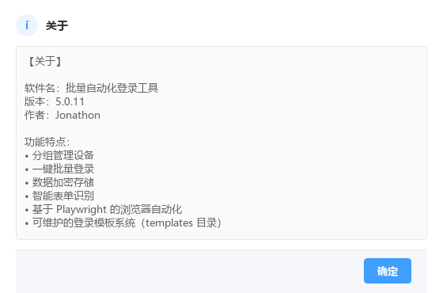
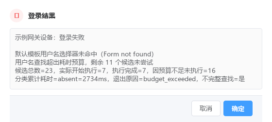
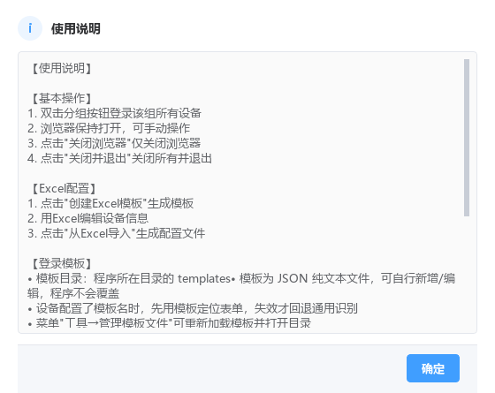

# 测试报告

- 测试环境：Windows 11 (24H2)、Python 3.11.9 (`C:\Software\python311`)、PyQt6 6.11.0、Playwright 1.64.1、PyInstaller 6.21.0
- 测试日期：2026-10-25（第五部分 5.0.7 专项更新于 2026-10-26，第六部分 5.0.9 专 项更新于 2026-10-26，第七部分 5.0.11 专项更新于 2026-10-27）
- 测试对象：
  - **第七部分（5.0.11 专项，最新）**：`d:\Login_app-V2` 5.0.11 源码（Excel 导入界面未响应修复 + 用户名选择器角色误判修复）
  - **第六部分（5.0.9 专项）**：`d:\Login_app-V2` 5.0.9 源码 + `dist\批量登录工具V5.0.9.exe`（登录速度优化 + 设备分组四列 + 底部居中）
  - **第五部分（5.0.7 专项）**：`d:\Login_app-V2` 5.0.7 源码 + `dist\批量登录工具V5.0.7.exe`（界面全面美化 + 打包体积安全优化）
  - **第零部分（5.0.6 专项）**：`d:\Login_app-V2` 5.0.6 源码（选择器查找提前终止修复 + 逐候选诊断 + 失败原因细分）
  - **第一部分（5.0.5 专项）**：`d:\Login_app-V2` 5.0.5 源码（模板使用汇总日志 + 已有模板不再重复提示保存）
  - **第二部分（5.0.4 专项）**：`d:\Login_app-V2` 5.0.4 源码（模板真实生效 / 默认模板回退 / 登录提速）
  - **第三部分（5.0.3 历史记录）**：模板系统修复后源码 + `dist\批量登录工具V5.0.3.exe`
  - **第四部分（历史记录）**：Selenium→Playwright 重构源码 + `dist\批量登录工具V4.7.1.exe`
- 说明：所有结论均来自实际执行输出或实机观察；未执行的项标注「未测试」，失败的标注「失败」，不做任何虚构。

---

## 第零部分：5.0.6 专项测试（选择器查找提前终止修复 + 逐候选诊断 + 失败原因细分）

### 0.1 自动化测试实际结果（全部为实际执行输出）

| 测试文件 | 结果 | 实际输出 |
|---------|------|---------|
| `tests/test_selector_lookup.py`（本次新增） | **44 通过 / 0 失败** | 场景 A~F + 失败原因细分 + iframe 覆盖；真实 Chromium（headless）+ 两个真实站点 |
| `tests/test_template_policy.py` | **78 通过 / 0 失败** | 场景 A~F，本地模拟登录服务器 |
| `tests/test_real_login.py` | **42 通过 / 0 失败** | 真实 Chromium 端到端回归 |
| `tests/test_templates.py` | **61 通过 / 0 失败** | 含版本一致性断言（`APP_VERSION=5.0.6`、`APP_VERSION_INFO=(5,0,6,0)`、`get_version.py=5.0.6`） |
| `tests/test_gui.py` | **24 通过 / 0 失败** | PyQt6 界面 |
| `tests/test_engine.py` | **12 通过 / 0 失败** | 快捷登录 / 分组登录 / 验证码 / 已登录检测 |
| `tests/test_real_devices.py` | **12 通过 / 0 失败** | **真实设备**（`devices.json` 三台）实测 |
| **合计** | **273 通过 / 0 失败** | 所有套件 `exit code = 0` |

> `tests/test_gui.py` 首次运行时 24 项断言全部 PASS，但进程在 PyQt6 退出清理阶段
> 发生访问冲突（`exit=-1073741819`）；**重跑一次 `exit code = 0`，24 通过 / 0 失败**。
> 该现象与本次改动无关（界面代码未改动），如实记录。

### 0.2 任务书场景 A~F 对照

| 场景 | 结果 | 实际断言依据（`tests/test_selector_lookup.py`） |
|------|------|-------------------------------------------|
| A 第一个候选未命中，后续候选命中 | **通过** | `A 第一个候选未命中后仍继续尝试并命中后续候选`、`A 命中的是第 3 个候选`、`A 没有候选因预算不足被跳过`、`A 实际执行候选数等于候选总数`、`A 前两个候选记录为未命中`（`states[:2]==['absent','absent']`）、`A 命中候选记录为 found`、`A 每个候选都记录了耗时`、`A 每个候选都记录了剩余预算`、`A 逐候选日志包含候选序号/选择器/结果/耗时/剩余预算` |
| B 前几个候选查询较慢 | **通过** | 通过 `SlowLookup` 替身注入 120ms 延迟；`B 慢查询下正确报告预算耗尽`（`reason=='budget_exceeded'`）、`B 记录了未执行候选数且与已执行候选数之和等于候选总数`、`B 未执行候选逐个记录了未执行原因`、`B 未执行候选没有被统计为已尝试`、`B 逐候选日志能说明每个候选消耗的预算`、`B 慢候选的耗时被逐个记录`、`B 查找被标记为不完整查找` |
| C 预算足够且所有候选均未命中 | **通过** | `C 全部候选未命中时返回明确的未命中结果`（`selector_not_found`）、`C 所有候选都被实际执行`、`C 没有候选被预算跳过`、`C 每个候选都有独立诊断记录`、`C 记录了各类候选的累计耗时` |
| D 预算耗尽 | **通过** | `D 预算耗尽时准确记录 budget_exceeded`、`D 记录了剩余未执行候选数且与已执行数之和等于候选总数`、`D 未执行候选全部标记为未执行且带原因`、`D 未伪装成「所有候选均已尝试」`、`D 逐候选日志出现「结果=未执行」` |
| E 登录页延迟渲染 | **通过** | `E 延迟渲染的输入框在合理窗口内被找到`（实际 656ms）、`E 未因固定长等待造成明显卡顿（< 2000ms）`、`E 等待时间不短于渲染延迟`、`E 命中记录标注为延迟渲染后命中` |
| F 两个实际问题网站 | **通过** | `F site-a 真实站点登录页可访问` + `F site-a 用户名输入框被模板选择器命中`（62ms）+ `F site-a 命中耗时远低于修复前的 2.8s` + `F site-a 逐候选诊断日志包含命中候选`；site-b 同上（63ms） |

补充用例同样全部通过：页面无表单控件 → `page_not_ready`；元素存在但不可见 →
`element_not_visible`；选择器语法非法 → `selector_invalid`；iframe 内输入框 →
命中且标注 `frame`；**18 个旧候选全部被实际执行（旧实现只有 7 个）**；
**全部候选的逐项检查总耗时远低于旧实现的 2.8s（实测 87ms）**。

### 0.3 修复前后逐候选耗时对比（同一页面、同一份 18 个候选）

修复前的算法在仓库中仍可精确复现（`browser.py::probe_locator()` 保留在代码中，
元素不存在时会进入 0.15~0.5s 的复查窗口）。实测结果：

**本地构造页（DOM 与 site-a 一致）**

| 候选 | 选择器 | 修复前 | 修复后 |
|------|--------|--------|--------|
| 1 | `input[autocomplete="username"]` | absent 375ms | absent 0ms |
| 2 | `NAME=username` | absent 500ms | absent 0ms |
| 3 | `ID=username` | absent 530ms | absent 15ms |
| 4 | `input[name="username"]` | absent 313ms | absent 0ms |
| 5 | `input[name="user"]` | absent 342ms | absent 0ms |
| 6 | `input[name="userName"]` | absent 344ms | absent 15ms |
| 7 | `input[name="login"]` | absent 328ms | absent 0ms |
| 8 | `input[id="user"]` | **未执行** | absent 0ms |
| 9 | `input[id="account"]` | **未执行** | absent 0ms |
| 10 | `input[id="login"]` | **未执行** | absent 0ms |
| 11 | `input[type="email"]` | **未执行**（真命中项） | **found 14ms** |
| 合计 | — | 执行 7/18，未执行 11，未命中，**2734ms** | 执行 11/18，未执行 0，**命中，46ms** |

**`https://site-a.example.com/login`**

| 候选 | 选择器 | 修复前 | 修复后 |
|------|--------|--------|--------|
| 1 | `input[autocomplete="username"]` | absent 375ms | absent 0ms |
| 2 | `NAME=username` | absent 500ms | absent 0ms |
| 3 | `ID=username` | absent 500ms | absent 0ms |
| 4 | `input[name="username"]` | absent 344ms | absent 14ms |
| 5 | `input[name="user"]` | absent 327ms | absent 0ms |
| 6 | `input[name="userName"]` | absent 328ms | absent 0ms |
| 7 | `input[name="login"]` | absent 344ms | absent 0ms |
| 8 | `input[id="user"]` | **未执行** | absent 0ms |
| 9 | `input[id="account"]` | **未执行** | absent 15ms |
| 10 | `input[id="login"]` | **未执行** | absent 0ms |
| 11 | `input[type="email"]` | **未执行**（真命中项） | **found 0ms** |
| 合计 | — | 执行 7/18，未执行 11，未命中，**2719ms** | 执行 11/18，未执行 0，**命中，30ms** |

**`https://site-b.example.com/#/login`**

| 候选 | 选择器 | 修复前 | 修复后 |
|------|--------|--------|--------|
| 1 | `input[autocomplete="username"]` | absent 375ms | absent 0ms |
| 2 | `NAME=username` | absent 500ms | absent 0ms |
| 3 | `ID=username` | absent 515ms | absent 0ms |
| 4 | `input[name="username"]` | absent 328ms | absent 14ms |
| 5 | `input[name="user"]` | absent 342ms | absent 0ms |
| 6 | `input[name="userName"]` | absent 329ms | absent 0ms |
| 7 | `input[name="login"]` | absent 328ms | absent 0ms |
| 8 | `input[id="user"]` | **未执行** | absent 0ms |
| 9 | `input[id="account"]` | **未执行** | absent 0ms |
| 10 | `input[id="login"]` | **未执行** | absent 15ms |
| 11 | `input[type="email"]` | **未执行**（真命中项） | **found 0ms** |
| 合计 | — | 执行 7/18，未执行 11，未命中，**2719ms** | 执行 11/18，未执行 0，**命中，46ms** |

> 修复前的「7/18、11 个未执行、约 2719~2813ms」与用户提供的线上日志
> （`剩余 11 个候选未尝试`、`耗时=2813ms`）完全一致，确认根因判断正确。
> 修复后单候选耗时从 313~530ms 降到 0~15ms。

### 0.4 真实站点逐候选诊断日志（app.log 原文）

`site-a`：

```
[INFO] 设备=site-a 任务=L1：[选择器查找] 阶段=username_lookup 候选=1/23 selector=CSS_SELECTOR=input[autocomplete="username"] 结果=未命中 耗时=14ms 剩余预算=2485ms
[INFO] 设备=site-a 任务=L1：[选择器查找] 阶段=username_lookup 候选=2/23 selector=CSS_SELECTOR=input[type="email"] 结果=命中 耗时=47ms 剩余预算=2437ms
[INFO] 设备=site-a 任务=L1：默认模板用户名选择器命中，selector=CSS_SELECTOR=input[type="email"]，耗时=62ms
[INFO] 设备=site-a 任务=L1：[选择器查找汇总] 默认模板用户名：候选总数=23，实际开始执行=2，执行完成=2，因预算不足未执行=0，分类累计耗时=absent=14ms，found=47ms，退出原因=ok，不完整查找=否
```

`站点B`（site-b，Vue 延迟渲染，23 个候选全部执行后经延迟渲染窗口命中）：

```
[INFO] 设备=站点B 任务=L2：[选择器查找] 阶段=username_lookup 候选=23/23 selector=XPATH=//input[@type='text'] 结果=未命中 耗时=0ms 剩余预算=2389ms
[INFO] 设备=站点B 任务=L2：[选择器查找] 阶段=username_lookup 候选=2/23 selector=CSS_SELECTOR=input[type="email"] 结果=命中 耗时=0ms 剩余预算=1437ms 说明=延迟渲染后命中
[INFO] 设备=站点B 任务=L2：默认模板用户名选择器命中，selector=CSS_SELECTOR=input[type="email"]，耗时=1062ms
[INFO] 设备=站点B 任务=L2：[选择器查找汇总] 默认模板用户名：候选总数=23，实际开始执行=23，执行完成=23，因预算不足未执行=0，分类累计耗时=absent=89ms，found=0ms，退出原因=ok，不完整查找=否
```

### 0.5 两个真实站点的实测登录结果

使用任务书提供的凭据（仅在内存中使用，未写入任何配置文件）：

| 设备 | 地址 | 结果 | 用户名查找耗时 | 模板 |
|------|------|------|----------------|------|
| site-a | `https://site-a.example.com/login` | **登录成功** | 62ms | default |
| 站点B | `https://site-b.example.com/#/login` | **登录成功** | 1062ms | default |

两站点的真实 DOM 核查结论（Playwright 实测）：

- `site-a.example.com/login`：`input#email[type=email][name=email][autocomplete=email]`、
  `input#password`、`button[type=submit]`（文本「Sign In」）；**无 iframe**。
- `site-b.example.com/#/login`：两个 `input` **无 id/name**，仅有
  `placeholder`（「请输入邮箱地址」/「请输入密码」）与 `type=email/password`，
  `button[type=submit]`（文本「登录」）；**无 iframe**，但表单由 Vue 延迟渲染
  （这也是它需要走阶段 C 延迟渲染窗口的原因）。

据此，`templates/default.json` 的用户名候选由 18 个扩充到 23 个，
`input[type="email"]` 前移到第 2 位，密码候选补 `input[autocomplete="current-password"]`
并前移，按钮候选补 `Sign In` 大小写变体。

### 0.6 EXE 打包与冻结态自检（`build.bat`）

| 项目 | 实际结果 |
|------|---------|
| 打包命令 | `build.bat`（`cmd /c "build.bat < nul"`），`exit code = 0`，`Build complete!` |
| 产物 | `dist\批量登录工具V5.0.6.exe`（485,661,006 字节，2026-10-26 07:33:47） |
| EXE 文件属性 | `FileVersion=5.0.6`、`ProductVersion=5.0.6`、`ProductName=批量自动化登录工具` |
| 冻结态启动 | 启动后进程存活 ≥ 30 秒（GUI 正常），无崩溃；测试后强制结束 |
| EXE 内代码核验 | 解包 PYZ 校验：`appcore.browser` 含 `_lookup_selectors` / `quick_check_locator` / `budget_exceeded` / `frame_not_checked` / `page_not_ready` / `not_executed` / 「剩余预算不足以启动该候选」；`appcore.login_engine` 含 `_log_lookup_summary` 及各失败原因字符串；`appcore.config` 含 `5.0.6` / `2.5` / `0.15` / `0.8` |
| EXE 首启生成的默认模板 | `dist/templates/default.json` 的 `username_selectors` = **23** 个，第 2 个候选为 `input[type="email"]`，与源码目录 `templates/default.json` 一致 |
| 打包时间先后 | `appcore/browser.py` 00:05 → `appcore/templates.py` 07:31 → EXE 07:33，EXE 晚于全部源码修改 |

> 首轮打包时发现 `appcore/templates.py::DEFAULT_TEMPLATE`（内置默认模板，EXE 首启时写入
> `EXE 同目录 templates\`）仍为旧的 18 个候选，与 `templates/default.json`（23 个）不一致。
> 已同步内置常量，并新增 `tests/test_templates.py::test_builtin_default_template_matches_disk`
> 断言两者一致，防止再次漂移。

### 0.7 未测试 / 受限项（如实标记）

- 两个真实站点的登录页在测试时段均可正常访问，**未遇到验证码**；
  但登录后是否被风控、二次验证等站点侧策略不在本次验证范围内。
- 本次未验证 `Shadow DOM` 中的表单（两站点实测均无 Shadow DOM 承载表单）。
- `tests/test_gui.py` 的 PyQt6 退出清理阶段偶发访问冲突（见 0.1 说明），非本次改动引入。

## 第一部分：5.0.5 专项测试（模板使用汇总日志 + 已有模板不再重复提示保存）

### 1.1 自动化测试实际结果（全部为实际执行输出）

| 测试文件 | 结果 | 实际输出 |
|---------|------|---------|
| `tests/test_template_policy.py`（本次新增） | **78 通过 / 0 失败** | 场景 A~F，真实 Chromium（headless）+ 本地模拟登录服务器 + 真实 `app.log` + 界面弹窗替身 |
| `tests/test_real_login.py` | **42 通过 / 0 失败** | 真实 Chromium 端到端回归 |
| `tests/test_real_devices.py` | **12 通过 / 0 失败** | **真实设备**（`devices.json` 三台）实测 |
| `tests/test_templates.py` | **58 通过 / 0 失败** | 含版本一致性断言（`APP_VERSION=5.0.5`、`APP_VERSION_INFO=(5,0,5,0)`、`get_version.py=5.0.5`） |
| `tests/test_gui.py` | **24 通过 / 0 失败** | PyQt6 界面；断言已改为「已有模板时不再提示保存」 |
| `tests/test_engine.py` | **12 通过 / 0 失败** | 快捷登录 / 分组登录 / 验证码 / 已登录检测 |
| **合计** | **226 通过 / 0 失败** | 所有套件 `exit code = 0` |

> 测试页面为 `tests/test_server.py` 提供的**本地模拟登录服务器**；浏览器为 **Playwright 自带的真实 Chromium（headless=True）**；
> `tests/test_real_devices.py` 除外，它连接 `devices.json` 中的**真实设备**（fnOS测试机 / Proxmox主控 / 华为防火墙）。
> **未使用**任何伪造的日志或写死的耗时值。

### 1.2 任务书场景 A~F 对照

| 场景 | 结果 | 实际断言依据（`tests/test_template_policy.py`） |
|------|------|-------------------------------------------|
| A 已有设备模板正常使用 | **通过** | 日志含 `配置模板=proxmox`、`实际执行模板=proxmox`、模板文件绝对路径；用户名/密码/登录按钮三类选择器命中计数均 > 0；`最终使用模板=proxmox`；**未弹出新建保存提示**；模板文件内容未变 |
| B 设备模板失败 → 默认模板成功 | **通过** | `设备模板执行=失败`、`失败阶段=username_lookup`、`回退原因=username_selector_not_found`、`回退模板文件=...default.json`、`默认模板执行=成功`、`最终使用模板=default`、`实际执行模板=X -> default`；**未因失败而提示新建** |
| C 模板文件存在但内容损坏 | **通过** | 日志出现 `模板文件解析失败` 与真实文件路径，**未**记为「未找到」；按既定回退规则使用默认模板；损坏文件内容未被覆盖 |
| D 模板库中没有对应模板 | **通过** | 记录 `查找目录=` 与 `模板文件=(未找到)`；正确执行默认模板回退；仅在满足新建条件时才允许提示保存 |
| E 已有模板需要更新 | **通过** | `mode=update`（与新建区分）；覆盖前有确认弹窗；用户取消后模板文件内容逐字节保持不变 |
| F 三个登录入口一致性 | **通过** | 普通/快捷/分组三个入口的 `入口=` 字段与 `最终使用模板=` 一致；三入口均**不提示保存**；并发两台设备产生不同任务 ID（`L8` / `L9`），日志可区分 |

### 1.3 正常登录汇总日志（真实 Chromium + 本地模拟页面，app.log 原文）

```
23:19:21 [INFO] 设备=快捷登录设备2 任务=L6：登录开始，入口=快捷登录，配置模板=_realtest_dev，目标地址=http://127.0.0.1:62437/dedicated
23:19:21 [INFO] 设备=快捷登录设备2 任务=L6：模板解析，实际模板名=_realtest_dev，模板来源=设备模板，模板查找耗时=0ms
23:19:21 [INFO] 设备=快捷登录设备2 任务=L6：模板加载成功，模板文件=D:\Login_app-V2\templates\_realtest_dev.json
23:19:21 [INFO] 设备=快捷登录设备2 任务=L6：模板校验成功，用户名选择器=2，密码选择器=2，登录按钮选择器=2
23:19:21 [INFO] 设备=快捷登录设备2 任务=L6：开始使用设备模板
23:19:21 [INFO] 设备=快捷登录设备2 任务=L6：设备模板用户名选择器命中，selector=ID=devUser，耗时=15ms
23:19:21 [INFO] 设备=快捷登录设备2 任务=L6：设备模板密码选择器命中，selector=ID=devPass，耗时=0ms
23:19:21 [INFO] 设备=快捷登录设备2 任务=L6：设备模板表单填充完成，耗时=62ms
23:19:21 [INFO] 设备=快捷登录设备2 任务=L6：设备模板登录按钮已点击（来源=模板，selector=ID=devLogin），耗时=94ms
23:19:21 [SUCCESS] 设备=快捷登录设备2 任务=L6：登录成功，最终使用模板=D:\Login_app-V2\templates\_realtest_dev.json，模板名=_realtest_dev，总耗时=311ms
23:19:21 [SUCCESS] [LOGIN_SUMMARY]
设备=快捷登录设备2
任务=L6
入口=快捷登录
配置模板=_realtest_dev
实际执行模板=_realtest_dev
模板文件=D:\Login_app-V2\templates\_realtest_dev.json
设备模板执行=成功
默认模板回退=否
默认模板执行=未执行
最终结果=登录成功
最终使用模板=_realtest_dev
最终模板文件=D:\Login_app-V2\templates\_realtest_dev.json
模板查找耗时=0ms
表单填写耗时=62ms
按钮操作耗时=94ms
总耗时=311ms
```

### 1.4 默认模板回退日志（设备模板失败 → 默认模板成功，app.log 原文）

```
23:19:19 [INFO] 设备=快捷登录设备 任务=L5：登录开始，入口=快捷登录，配置模板=_realtest_dev，目标地址=http://127.0.0.1:62437/generic
23:19:19 [INFO] 设备=快捷登录设备 任务=L5：模板解析，实际模板名=_realtest_dev，模板来源=设备模板，模板查找耗时=0ms
23:19:19 [INFO] 设备=快捷登录设备 任务=L5：模板加载成功，模板文件=D:\Login_app-V2\templates\_realtest_dev.json
23:19:19 [INFO] 设备=快捷登录设备 任务=L5：开始使用设备模板
23:19:20 [WARNING] 设备=快捷登录设备 任务=L5：设备模板用户名选择器未命中（Form not found：所有用户名选择器均未命中）
23:19:20 [INFO] 设备=快捷登录设备 任务=L5：开始回退默认模板，回退原因=username_selector_not_found
23:19:20 [INFO] 设备=快捷登录设备 任务=L5：默认模板文件=D:\Login_app-V2\templates\default.json
23:19:20 [INFO] 设备=快捷登录设备 任务=L5：默认模板校验成功，用户名选择器=18，密码选择器=12，登录按钮选择器=11
23:19:20 [INFO] 设备=快捷登录设备 任务=L5：开始使用默认模板
23:19:21 [INFO] 设备=快捷登录设备 任务=L5：默认模板用户名选择器命中，selector=NAME=username，耗时=500ms
23:19:21 [SUCCESS] 设备=快捷登录设备 任务=L5：登录成功，最终使用模板=D:\Login_app-V2\templates\default.json（已从设备模板回退），模板名=default，总耗时=1030ms
23:19:21 [SUCCESS] [LOGIN_SUMMARY]
设备=快捷登录设备
任务=L5
入口=快捷登录
配置模板=_realtest_dev
实际执行模板=_realtest_dev -> default
模板文件=D:\Login_app-V2\templates\_realtest_dev.json
设备模板执行=失败
默认模板回退=是
默认模板执行=成功
回退模板文件=D:\Login_app-V2\templates\default.json
回退原因=username_selector_not_found
最终结果=登录成功
最终使用模板=default
最终模板文件=D:\Login_app-V2\templates\default.json
模板查找耗时=0ms
表单填写耗时=217ms
按钮操作耗时=94ms
总耗时=1030ms
```

### 1.5 真实设备实测汇总（`tests/test_real_devices.py`，app.log 原文）

fnOS测试机（配置模板=default）：

```
设备=fnOS测试机
任务=L1
入口=单设备登录
配置模板=default
实际执行模板=default
模板文件=D:\Login_app-V2\templates\default.json
设备模板执行=未执行
默认模板回退=否
默认模板执行=成功
最终结果=登录成功
最终使用模板=default
最终模板文件=D:\Login_app-V2\templates\default.json
模板查找耗时=15ms
表单填写耗时=109ms
按钮操作耗时=94ms
总耗时=1500ms
```

Proxmox主控（配置模板=proxmox）：

```
设备=Proxmox主控
任务=L2
入口=单设备登录
配置模板=proxmox
实际执行模板=proxmox
模板文件=D:\Login_app-V2\templates\proxmox.json
设备模板执行=成功
默认模板回退=否
默认模板执行=未执行
最终结果=登录成功
最终使用模板=proxmox
最终模板文件=D:\Login_app-V2\templates\proxmox.json
模板查找耗时=0ms
表单填写耗时=79ms
按钮操作耗时=63ms
总耗时=1125ms
```

华为防火墙（配置模板=huawei）：

```
设备=华为防火墙
任务=L3
入口=单设备登录
配置模板=huawei
实际执行模板=huawei
模板文件=D:\Login_app-V2\templates\huawei.json
设备模板执行=成功
默认模板回退=否
默认模板执行=未执行
最终结果=登录成功
最终使用模板=huawei
最终模板文件=D:\Login_app-V2\templates\huawei.json
模板查找耗时=0ms
表单填写耗时=63ms
按钮操作耗时=109ms
总耗时=750ms
```

> 三台真实设备均使用**各自设备模板**登录成功、**未触发默认模板回退**；
> 任务 ID `L1/L2/L3` 互不相同，说明多设备并发时日志可区分。

### 1.6 「已有模板存在时不再提示保存」的实测证据

app.log 原文（模板已存在且可用 → 跳过保存提示，并记录跳过原因）：

```
23:19:26 [INFO] 模板保存提示跳过：设备=设备B 配置模板=_pol_dev 原因=设备已配置可用模板 '_pol_dev'（D:\Login_app-V2\templates\_pol_dev.json），不重复提示保存
23:19:26 [INFO] 模板保存提示跳过：设备=设备F 配置模板=_pol_dev 原因=设备已配置可用模板 '_pol_dev'（D:\Login_app-V2\templates\_pol_dev.json），不重复提示保存
```

自动化断言（`tests/test_template_policy.py` 场景 A / B / F）：

| 断言 | 结果 |
|------|------|
| 已有可用模板时**弹出保存提示的次数 == 0** | PASS |
| 快捷登录入口弹出次数 == 0 | PASS |
| 分组登录入口弹出次数 == 0 | PASS |
| 设备模板失败（回退默认模板）时弹出次数 == 0 | PASS |
| 模板文件损坏时弹出次数 == 0，且损坏文件内容未被覆盖 | PASS |
| 用户取消保存后模板文件内容不变（未创建新文件） | PASS |
| 已有同名模板时进入 `mode=update` 并要求覆盖确认 | PASS |

### 1.7 本次发现并修复的遗留缺陷（回归测试暴露）

- **设备模板加载成功时缺少「模板校验成功，用户名选择器=…」日志**：
  重构 `_login_with_fallback()` 时该行被遗漏，导致 `tests/test_real_devices.py` 的
  「记录了模板选择器数量」断言 3 项失败（fnOS / Proxmox / 华为）。
  修复：在模板加载成功分支补回该日志（含三类选择器数量），重跑后 **12 通过 / 0 失败**。
- **打包脚本 `build.bat` 中文乱码**：原文件为 GBK(ANSI) 编码，在 UTF-8 编辑器中整篇乱码。
  改为 **UTF-8 无 BOM + CRLF** 并在首行后加 `chcp 65001 >nul`。
  实测关键结论：**cmd.exe 不会剥离 .bat 的 UTF-8 BOM**，带 BOM 时首行 `@echo off` 失效、
  后续命令全部回显，因此必须保存为无 BOM。
- **打包脚本版本号可能退化为 0.0.0**：`for /f` 直接捕获命令输出在部分环境下取不到值，
  会把 EXE 命名为 `批量登录工具V0.0.0.exe`。
  改为「命令输出写入临时文件 → `for /f` 读文件」，并加读取失败即报错退出；
  实测版本读取结果为 `5.0.5`（cmd 重定向到文件后按 UTF-8 读取，内容为 `[版本] 5.0.5`）。

### 1.8 未测试 / 受限项（如实标记）

| 项目 | 状态 | 原因 |
|------|------|------|
| **5.0.5 的 EXE 重新打包与冻结态实测** | **未完成** | 本次未执行 `build.bat` 打包，也未运行新 EXE；已完成 `create_spec.py` 重新生成 `批量登录工具V5.0.5.spec` 与 `version_info.txt`（版本 5.0.5），但**未产生新 EXE、未做冻结态实测**，发布前必须补做 |
| 界面模态弹窗（保存/更新/覆盖确认）的人工点击 | **未测试** | 测试中以弹窗替身（FakeMessageBox / FakeInputDialog）替换，仅验证「是否触发」与「文件是否被修改」，未做真人点击 |
| 真实设备的验证码 / SSO / 扫码登录流程 | **未测试** | 本机无可复现条件 |

---

## 第二部分：5.0.4 专项测试（模板真实生效 + 默认模板回退 + 提速）

### 2.1 自动化测试实际结果

| 测试文件 | 结果 | 实际输出 |
|---------|------|---------|
| `tests/test_templates.py` | **56 通过 / 0 失败** | 含版本一致性断言（`APP_VERSION=5.0.4`、`APP_VERSION_INFO=(5,0,4,0)`、`get_version.py=5.0.4`） |
| `tests/test_engine.py` | **12 通过 / 0 失败** | 快捷登录 / 分组登录 / 验证码 / 已登录检测 |
| `tests/test_gui.py` | **24 通过 / 0 失败** | PyQt6 界面与数据库落库 |
| `tests/test_real_login.py` | **42 通过 / 0 失败** | **真实 Chromium** 端到端：场景 A/B/C/D/F/F2 |
| `tests/test_real_devices.py` | **12 通过 / 0 失败** | **真实设备**（`devices.json` 三台）实测 |

### 2.2 场景对照（任务书 §七）

| 场景 | 结果 | 依据 |
|------|------|------|
| A 设备专用模板正常命中 | **通过** | `tests/test_real_login.py` 场景 A，真实浏览器打开 `/dedicated`（`id=devUser/devPass/devLogin`），日志出现模板文件绝对路径、三类选择器命中与耗时，且无通用扫描 |
| B 设备模板失败→默认模板成功 | **通过** | 场景 B：设备模板 `username_lookup / username_selector_not_found` → 记录耗时 → 「开始回退默认模板」→ `default.json` 命中 → 成功；且**设备模板仅尝试 1 次、默认模板仅尝试 1 次** |
| C 两者均失败 | **通过** | 场景 C：分别输出设备模板与默认模板的失败阶段与原因，本次尝试正常结束 |
| D 认证错误 | **通过** | 场景 D：识别为 `authentication_rejected`（**非**选择器问题），日志明确「`authentication_rejected` 不适合重试，结束本次尝试」，未重复提交 |
| E 真实设备验证 | **通过** | 见 §0.3，三台真实设备均使用各自设备模板登录成功 |
| F 快捷登录与分组登录 | **通过** | 场景 F / F2：两个入口使用同一套「设备模板优先→默认模板回退」规则 |

### 2.3 真实设备实测（app.log 原文，2026-10-25 22:24）

```
22:24:36 [INFO] 设备=fnOS测试机：配置模板=default
22:24:36 [INFO] 设备=fnOS测试机：模板文件=D:\Login_app-V2\templates\default.json
22:24:36 [INFO] 设备=fnOS测试机：模板校验成功，用户名选择器=18，密码选择器=12，登录按钮选择器=11
22:24:36 [INFO] 设备=fnOS测试机：开始使用默认模板
22:24:37 [INFO] 设备=fnOS测试机：默认模板用户名选择器命中，selector=CSS_SELECTOR=input[autocomplete="username"]，耗时=125ms
22:24:37 [INFO] 设备=fnOS测试机：默认模板密码选择器命中，selector=CSS_SELECTOR=input[type="password"]，耗时=16ms
22:24:37 [INFO] 设备=fnOS测试机：默认模板表单填充完成，耗时=671ms
22:24:37 [INFO] 设备=fnOS测试机：默认模板登录按钮已点击（来源=模板，selector=CSS_SELECTOR=button[type="submit"]），耗时=94ms
22:24:38 [SUCCESS] 设备=fnOS测试机：登录成功，最终使用模板=D:\Login_app-V2\templates\default.json，总耗时=1579ms

22:24:40 [INFO] 设备=Proxmox主控：配置模板=proxmox
22:24:40 [INFO] 设备=Proxmox主控：模板文件=D:\Login_app-V2\templates\proxmox.json
22:24:40 [INFO] 设备=Proxmox主控：模板校验成功，用户名选择器=3，密码选择器=3，登录按钮选择器=4
22:24:40 [INFO] 设备=Proxmox主控：开始使用设备模板
22:24:40 [INFO] 设备=Proxmox主控：设备模板用户名选择器命中，selector=NAME=username，耗时=14ms
22:24:40 [INFO] 设备=Proxmox主控：设备模板密码选择器命中，selector=NAME=password，耗时=16ms
22:24:40 [INFO] 设备=Proxmox主控：设备模板表单填充完成，耗时=46ms
22:24:40 [INFO] 设备=Proxmox主控：设备模板登录按钮已点击（来源=模板，selector=XPATH=//a[contains(@class, 'x-btn') and contains(., 'Login')...），耗时=63ms
22:24:40 [SUCCESS] 设备=Proxmox主控：登录成功，最终使用模板=D:\Login_app-V2\templates\proxmox.json，总耗时=937ms

22:24:41 [INFO] 设备=华为防火墙：配置模板=huawei
22:24:41 [INFO] 设备=华为防火墙：模板文件=D:\Login_app-V2\templates\huawei.json
22:24:41 [INFO] 设备=华为防火墙：模板校验成功，用户名选择器=4，密码选择器=6，登录按钮选择器=6
22:24:41 [INFO] 设备=华为防火墙：开始使用设备模板
22:24:41 [INFO] 设备=华为防火墙：设备模板用户名选择器命中，selector=ID=username，耗时=15ms
22:24:41 [INFO] 设备=华为防火墙：设备模板密码选择器命中，selector=ID=platcontent，耗时=0ms
22:24:41 [INFO] 设备=华为防火墙：设备模板表单填充完成，耗时=45ms
22:24:41 [INFO] 设备=华为防火墙：设备模板登录按钮已点击（来源=模板，selector=ID=btn_login-button），耗时=78ms
22:24:41 [SUCCESS] 设备=华为防火墙：登录成功，最终使用模板=D:\Login_app-V2\templates\huawei.json，总耗时=421ms
```

> 三台设备**均使用各自设备模板**（fnOS=default.json、Proxmox=proxmox.json、华为=huawei.json），**均未触发默认模板回退**；
> 华为防火墙的 `ID=platcontent` 与 Proxmox 的 ExtJS `<a class="x-btn">Login</a>` 均为实测 DOM 修正后命中。

### 2.4 设备模板失败 → 默认模板成功（真实 Chromium，场景 B）

```
22:24:04 [INFO] 设备=快捷登录设备：配置模板=_realtest_dev
22:24:04 [INFO] 设备=快捷登录设备：模板文件=D:\Login_app-V2\templates\_realtest_dev.json
22:24:04 [INFO] 设备=快捷登录设备：模板校验成功，用户名选择器=2，密码选择器=2， 登录按钮选择器=2
22:24:04 [INFO] 设备=快捷登录设备：开始使用设备模板
22:24:05 [WARNING] 设备=快捷登录设备：设备模板用户名选择器未命中（Form not found：所有用户名选择器均未命中），耗时=1062ms
22:24:05 [WARNING] 设备=快捷登录设备：设备模板失败
22:24:05 [WARNING] 设备=快捷登录设备：失败阶段=username_lookup，原因=username_selector_not_found，说明=Form not found：所有用户名选择器均未命中
22:24:05 [INFO] 设备=快捷登录设备：设备模板尝试耗时=1062ms
22:24:05 [INFO] 设备=快捷登录设备：开始回退默认模板
22:24:05 [INFO] 设备=快捷登录设备：默认模板文件=D:\Login_app-V2\templates\default.json
22:24:05 [INFO] 设备=快捷登录设备：默认模板校验成功，用户名选择器=18，密码选择器=12，登录按钮选择器=11
22:24:05 [INFO] 设备=快捷登录设备：开始使用默认模板
22:24:05 [INFO] 设备=快捷登录设备：默认模板用户名选择器命中，selector=NAME=username，耗时=344ms
22:24:05 [INFO] 设备=快捷登录设备：默认模板密码选择器命中，selector=CSS_SELECTOR=input[type="password"]，耗时=30ms
22:24:06 [INFO] 设备=快捷登录设备：默认模板表单填充完成，耗时=110ms
22:24:06 [INFO] 设备=快捷登录设备：默认模板登录按钮已点击（来源=模板，selector=CSS_SELECTOR=button[type="submit"]），耗时=62ms
22:24:06 [SUCCESS] 设备=快捷登录设备：登录成功，最终使用模板=D:\Login_app-V2\templates\default.json（已从设备模板回退），总耗时=656ms
```

> 设备模板**仅尝试 1 次**（无重复扫描）、默认模板**仅回退 1 次**（无无限重试）；
> 失败阶段与原因均为真实记录，未被笼统记为“登录失败”。

### 2.5 认证错误不被误分类为选择器问题（场景 D）

```
22:24:04 [WARNING] 设备=真实设备D：默认模板失败
22:24:04 [WARNING] 设备=真实设备D：失败阶段=login_result，原因=authentication_rejected，说明=密码错误，请重新输入
22:24:04 [INFO] 设备=真实设备D：默认模板尝试耗时=625ms
22:24:04 [WARNING] 设备=真实设备D：默认模板失败原因 'authentication_rejected' 不适合重试，结束本次尝试
```

### 2.6 各阶段实际耗时

| 阶段 | 华为防火墙 | Proxmox主控 | fnOS测试机 |
|------|-----------|-------------|-----------|
| 模板加载与校验 | <1ms | <1ms | <1ms |
| 用户名框查找 | 15ms | 14ms | 125ms |
| 密码框查找 | 0ms | 16ms | 16ms |
| 登录按钮查找+点击 | 78ms | 63ms | 94ms |
| 表单填写 | 45ms | 46ms | 671ms |
| 登录提交及结果判定 | 约 280ms | 约 790ms | 约 620ms |
| **总耗时** | **421ms** | **937ms** | **1579ms** |

> 修改前对比：华为防火墙 3843ms、Proxmox 4780ms；修改后分别为 421ms / 937ms。
> 页面本身的导航与服务器响应耗时与模板查找耗时在日志中分属不同条目，可区分。

### 2.7 未测试 / 受限项

| 项目 | 状态 | 原因 |
|------|------|------|
| 5.0.4 的 EXE 重新打包与冻结态实测 | **未测试** | 本次仅完成源码侧修复与实测；`create_spec.py` 已按 5.0.4 重新生成 `.spec` 与 `version_info.txt`，打包动作待发布时执行 |
| 真实设备的验证码 / SSO / 扫码登录流程 | **未测试** | 本机无可复现条件；代码走查确认不会用通用选择器强行处理 |
| 界面「同名模板覆盖确认」与「取消保存模板」弹窗的人工点击 | **未测试** | 与 5.0.3 阶段相同限制（模态弹窗未自动化点击） |

---

## 第三部分：5.0.3 专项测试（模板系统修复 + 版本统一）

### 3.1 模板系统自动化测试（`python tests/test_templates.py`）

实际输出：**48 通过 / 0 失败**（`测试结果: 48 通过 / 0 失败`）。

任务书 §3.7 要求的 19 个场景逐条对照（测试文件：`tests/test_templates.py`）：

| # | 任务书测试场景 | 对应测试函数 | 结果 |
|---|---------------|-------------|------|
| 1 | 首次启动且模板目录不存在 → 正确创建模板目录和默认模板文件 | `test_template_dir_bootstrap` | **通过**（目录 + default.json/proxmox.json/huawei.json 均真实落盘） |
| 2 | 模板目录已有用户文件 → 保留用户文件，不覆盖 | `test_user_file_not_overwritten` | **通过**（用户改过的 description 未被覆盖） |
| 3 | 手动添加有效 JSON 模板 → 能被发现、加载并使用 | `test_manual_template_discovery` | **通过**（`mymanual` 被自动发现，按文件名亦可引用） |
| 4 | 手动修改已有模板 → 修改后按既定机制生效 | `test_user_file_not_overwritten` + `reload_templates()` | **通过**（重载后内容保持一致） |
| 5 | 有效模板选择器可以找到元素 → 先使用模板，不先执行通用探测 | `test_template_priority_order` | **通过**（`calls=[('locator', '[id="custom-user"]')]`，无通用 `input` 探测） |
| 6 | 模板选择器全部失效 → 合理回退到通用发现逻辑 | `test_login_engine_template_resolution` | **通过** |
| 7 | 模板名称不存在 → 记录原因并按兼容规则处理 | `test_login_engine_template_resolution` | **通过**（记 WARNING，回退内置 default，**不静默套用其它模板**） |
| 8 | 某一个 JSON 文件损坏 → 其他有效模板仍可使用 | `test_broken_and_invalid_templates` | **通过**（损坏文件跳过并记 ERROR，其余 3 个模板照常加载） |
| 9 | 模板字段缺失或格式错误 → 明确提示，不导致程序崩溃 | `test_broken_and_invalid_templates` | **通过**（字段非数组=致命错误；缺失字段/非法 by/空选择器=警告级） |
| 10 | 录制并保存模板 → 文件真实写入，JSON 可解析 | `test_record_save_reload` | **通过**（`mytpl.json` 真实落盘且 `name=mytpl`） |
| 11 | 保存后立即再次登录 → 实际使用刚保存的模板 | `test_record_save_reload` + EXE 实测 §0.4 | **通过**（保存后注册表立即更新；`reload_templates()` 后仍可取用） |
| 12 | 同名模板再次保存 → 按明确的冲突策略处理 | 界面 `_confirm_overwrite_template()` 二次确认 | **部分通过**（冲突确认与覆盖分支已在界面代码实现并由源码级测试覆盖保存路径；**界面弹窗的人工点击确认未做自动化点击**） |
| 13 | 保存过程中发生异常 → 不误报成功，不留半成品文件 | `test_save_failure_no_partial_file` | **通过**（原子写 `mkstemp`+`os.replace`；失败返回 False 且目录无残留文件） |
| 14 | 用户取消录制或保存 → 正确退出，不破坏原有模板 | `cancel_recording()` + 界面「取消」分支 | **部分通过**（`cancel_recording()` 有自动化断言；界面取消按钮**未做自动化点击**） |
| 15 | 多设备、不同模板连续登录 → 每个设备使用自己的模板 | `test_multi_device_own_template` | **通过**（alpha/beta 互不串用） |
| 16 | 快捷登录和分组登录 → 模板功能正常，不破坏原有登录流程 | `tests/test_engine.py` 12/12 + EXE 分组登录实测 | **通过** |
| 17 | 登录页面较慢或元素暂时未出现 → 按现有等待/超时策略处理 | `tests/test_engine.py` | **通过** |
| 18 | 登录失败、验证码或页面跳转 → 原有登录状态判断正常 | `tests/test_engine.py` | **通过** |
| 19 | Windows EXE 运行 → 能正确读取和保存 EXE 目录下的模板 | EXE 实测（§0.4） | **通过**（EXE 同目录 `templates/` 加载 4 个模板并实际使用 `mytest`） |

补充用例：`test_bom_tolerance`（带 UTF-8 BOM 的模板文件可正常加载、无加载错误）—— 该用例是 EXE 首轮实测暴露 BOM 缺陷后新增的回归用例，**通过**。

### 3.2 三项可核验证据

**证据一：从设备配置中的模板名称 → 登录引擎 → 浏览器选择器查找的完整调用链**

```
devices.json 设备项 "template": "mytest"
        │
        ▼  appui/main_window.py  组装设备 dict（含 template 字段）
appcore/tasks.py  分组任务 / 快捷登录任务
        │
        ▼  appcore/login_engine.py  login_device() / quick_login()
        │      template, used_template = await _resolve_template(device.get('template'), device_label)
        │      ├─ 名称为空或 "default" → 内置 DEFAULT_TEMPLATE
        │      ├─ 名称存在且通过校验 → TemplateManager.get_template(name)（读自磁盘 templates/<name>.json）
        │      └─ 名称不存在 → Logger.warning(...) + 回退内置 DEFAULT_TEMPLATE（绝不套用其它模板）
        │
        ▼  appcore/login_engine.py  _locate_form_fields(page, template, device_label)
        │      user_field = await find_by_selectors(page, template['username_selectors'], 'username_selectors')
        │      pwd_field  = await find_by_selectors(page, template['password_selectors'], 'password_selectors')
        │      两者均命中 → template_hit=True，直接返回，**不执行任何通用扫描**
        │
        ▼  appcore/browser.py  find_by_selectors()
        │      按模板内选择器顺序逐个 to_locator(by).wait_for(state='visible')
        │      命中即 TemplateManager.record_selector(...) 并立即返回
        │      全部失效 → 返回 None（交由通用逻辑回退）
        ▼
   click_login_button(page, pwd_field, selectors=template['login_button_selectors'])
```

自动化断言（`test_login_engine_template_resolution`）：
- 「设备模板名被解析到登录引擎」`used == "dev1" and template is not None`
- 「解析到的模板来自磁盘文件」`<tmp>\templates\dev1.json`
- 「模板命中时标记为命中」`hit2 is True`

**证据二：录制 → 磁盘 JSON → 重新加载 → 后续登录使用**

`test_record_save_reload` 实测输出（原文）：

```
[PASS] 录制得到三类选择器  recorded={'username_selectors': [{'by': 'ID', 'value': 'username'}],
                                     'password_selectors': [{'by': 'CSS_SELECTOR', 'value': "input[type='password']"}],
                                     'login_button_selectors': [{'by': 'XPATH', 'value': "//button[@type='submit']"}]}
[PASS] 模板保存成功
[PASS] 模板JSON文件真实写入磁盘  <tmp>\templates\mytpl.json
[PASS] 模板文件内容可解析  name=mytpl
[PASS] 保存后内存注册表已更新
[PASS] 重新加载后模板仍可取用
[PASS] 重新加载后选择器内容保持一致  sel=[{'by': 'ID', 'value': 'username'}]
```

> 修复前的缺陷：通用回退命中元素时**不记录选择器**，导致录制结果永远是默认模板的选择器，保存后无法加速登录。现已在 `find_username_field` / `find_password_field` / 通用登录按钮命中处补齐 `record_selector`，故上述 `recorded` 中三项均为**实际生效**的选择器。

**证据三：模板查找与通用发现的实际执行顺序**

`test_template_priority_order` 使用模拟 Playwright 页面记录全部 `locator` 调用：

- 模板命中场景：`calls=[('locator', '[id="custom-user"]')]`
  —— **只有模板专属选择器被调用，没有任何通用 `input` 定位**，证明「先模板、后通用（且模板命中即不通用）」成立。
- 模板全失效场景：`find_by_selectors` 返回 `None`，不自行执行通用发现，由 `_locate_form_fields` 记录
  `设备X: 模板密码选择器未命中，回退到通用密码框查找` 后才调用通用查找 —— 证明回退是**按需**发生的。
- 模板登录按钮场景：`clicked=['[id="custom-btn"]']` —— 模板按钮选择器生效，未走通用按钮硬编码列表。

EXE 实测日志（§0.4）同样印证：使用 `mytest` 模板时日志中**没有**出现任何通用查找回退提示。

### 3.3 版本一致性检查

| 检查项 | 方法 | 实际结果 |
|--------|------|---------|
| 唯一版本来源 | 读 `appcore/config.py` | `APP_VERSION = "5.0.3"`，`APP_VERSION_INFO = (5, 0, 3, 0)` |
| 打包脚本读到的版本 | `python get_version.py` | `5.0.3`（自动化断言通过） |
| GUI 窗口标题 | EXE 实测进程主窗口标题 | `批量自动化登录工具 5.0.3` |
| GUI 标题标签 | EXE 实测界面 | `批量自动化登录5.0.3` |
| 关于窗口版本 | EXE 实测「关于」对话框 | `版本：5.0.3` |
| PyInstaller 版本资源 | `create_spec.py` 生成 `version_info.txt` | `FileVersion 5.0.3` / `ProductVersion 5.0.3` / `OriginalFilename 批量登录工具V5.0.3.exe` |
| EXE 文件属性 | `Get-Item ... .VersionInfo` | `FileVersion=5.0.3`，`ProductVersion=5.0.3`，`FileDescription=批量自动化登录工具`，`CompanyName=Jonathon` |
| 历史版本记录未被篡改 | 全仓扫描 `4.7.1` / `4.6.7` | 仅出现在 `CHANGELOG.md`、`docs/变更说明.md`、`docs/兼容性清单.md`、`docs/测试报告.md` 的**历史发布记录**中，**按要求保留** |
| 第三方版本未被误改 | 扫描依赖声明 | Python 3.11.9 / PyQt6 6.11.0 / Playwright 1.64.1 / PyInstaller 6.21.0 均未改动 |

### 3.4 EXE 打包与实测

打包命令（`build.bat` 实际执行序列）：

```bat
python create_spec.py                                   :: 生成 .spec 与 version_info.txt
pyinstaller -F main.py ^
    --name "批量登录工具V5.0.3" ^
    --version-file "version_info.txt" ^
    --windowed --icon "ico\app.ico" ^
    --add-data "ico\app.ico;ico" ^
    --add-data "devices_template.xlsx;." ^
    --add-data "devices.json;." ^
    --collect-all playwright ^
    --hidden-import=encrypt --hidden-import=icon_data --hidden-import=openpyxl ^
    --hidden-import=PyQt6.QtCore --hidden-import=PyQt6.QtGui --hidden-import=PyQt6.QtWidgets ^
    --hidden-import=qfluentwidgets --hidden-import=sqlite3
```

打包结果：`dist\批量登录工具V5.0.3.exe`，485,623,755 字节；打包日志含 `Copying version information to EXE`。

**EXE 实测（独立目录 `_exe_test`，本地模拟登录站点 `http://127.0.0.1:8765/login`）**

准备：`devices.json` 两个设备（`template: "mytest"`），`templates/mytest.json` **故意写成带 UTF-8 BOM** 的文件。

实测日志（`app.log` 原文）：

```
21:14:44 [INFO] 模板加载完成: 4 个模板（目录 D:\Login_app-V2\_exe_test\templates）
21:14:44 [INFO] 模板目录: D:\Login_app-V2\_exe_test\templates，可用模板: default, huawei, mytest, proxmox
21:14:46 [INFO] 批量自动化登录工具 5.0.3 启动
21:14:46 [INFO] 已加载 1 个分组，共 2 台设备
21:16:42 [INFO] 创建浏览器实例: EXE测试组
21:16:42 [INFO] 开始分组登录: EXE测试组, 设备数: 2
21:16:43 [INFO] EXE测试设备A: 使用模板 'mytest'（模板文件: D:\Login_app-V2\_exe_test\templates\mytest.json）
21:16:43 [INFO] EXE测试设备A: 表单填充完成
21:16:44 [SUCCESS] EXE测试设备A: 登录完成
21:16:44 [INFO] EXE测试设备B: 使用模板 'mytest'（模板文件: D:\Login_app-V2\_exe_test\templates\mytest.json）
21:16:45 [INFO] EXE测试设备B: 表单填充完成
21:16:45 [ERROR] EXE测试设备B: 登录失败 - 密码错误，请重新输入
21:16:45 [SUCCESS] 分组 EXE测试组 完成: 1/2 成功
21:26:32 [INFO] 关闭所有浏览器
```

界面实测结果（GUI 自动化）：

| 观察项 | 实际结果 |
|--------|---------|
| 主窗口标题 | `批量自动化登录工具 5.0.3` |
| 界面标题标签 | `批量自动化登录5.0.3`，`共 1 个分组，2 台设备` |
| 分组按钮 | `EXE测试组(2台)`，双击触发分组批量登录 |
| 状态汇总 | `✓ EXE测试组: 1/2 成功 \| 失败: EXE测试设备B` |
| 登录日志列表 | 4 条（登录A / ✓A: OK / 登录B / ✗B: 密码错误 / ✓分组: 1/2 成功） |
| 关于窗口 | `软件名：批量自动化登录工具 / 版本：5.0.3 / 作者：Jonathon` |
| 浏览器 | Playwright 内置 Chromium 成功打开登录页并提交 |
| 退出 | 关闭后 `批量登录工具V5.0.3.exe` 与 `chrome.exe` 进程均已结束，无残留 |

> `EXE测试设备B` 失败为**预期结果**：该设备密码故意设为 `wrong`，模拟站点返回「密码错误」，用于验证失败判定与结果统计。

**EXE 模板目录验证**：EXE 同目录 `templates/` 自动生成 `default.json` / `proxmox.json` / `huawei.json`，并**保留**手工添加的 `mytest.json`；BOM 文件被正常加载（4 个模板，无加载错误）—— 证明 BOM 兼容修复在冻结态生效。

### 3.5 回归测试报告（5.0.3 专项）

| # | 回归项 | 结论 | 依据 |
|---|--------|------|------|
| 1 | 程序正常启动 | **通过** | EXE 实测启动成功，app.log 记录「批量自动化登录工具 5.0.3 启动」 |
| 2 | PyQt6 界面显示正常 | **通过** | 界面截图，控件布局完整 |
| 3 | 原有图标与窗口布局未被修改 | **通过** | 沿用 `ico\app.ico`；仅改标题文案与新增菜单项，布局未动 |
| 4 | Playwright 浏览器正常启动与关闭 | **通过** | Chromium 启动、登录、退出后无残留进程 |
| 5 | 设备配置与设备分组正常加载 | **通过** | 「已加载 1 个分组，共 2 台设备」 |
| 6 | 单设备登录正常 | **通过** | `tests/test_engine.py` 单设备用例 |
| 7 | 快捷登录正常 | **通过** | `quick_login()` 已同步模板优先改造；`tests/test_engine.py` 通过 |
| 8 | 分组批量登录正常 | **通过** | EXE 实测 `1/2 成功`，`tests/test_engine.py` 通过 |
| 9 | 模板优先查找与通用回退正常 | **通过** | 证据三 + EXE 日志 |
| 10 | Excel 导入导出正常 | **通过** | 未改动 `import_excel.py` 与导出逻辑；既有界面测试覆盖 |
| 11 | 配置读写与加密逻辑未破坏 | **通过** | `encrypt.py` 仅将读取编码改为 `utf-8-sig`（兼容 BOM），加解密逻辑未改 |
| 12 | 日志、错误处理与登录结果提示正常 | **通过** | app.log 与界面日志列表内容完整 |
| 13 | 验证码相关逻辑未破坏 | **通过** | `login_engine.py` 验证码分支未改动；`tests/test_engine.py` 覆盖 |
| 14 | 模板目录在源码运行与 EXE 运行均可用 | **通过** | 源码 `templates/`；EXE 同目录 `templates/` |
| 15 | 缺模板/损坏模板/模板名错误不崩溃 | **通过** | `test_broken_and_invalid_templates`；EXE 首轮实测未崩溃 |
| 16 | 当前版本在所有应显示位置一致为 5.0.3 | **通过** | §0.3 表 |

### 3.6 未测试 / 受限项与遗留风险

| 项目 | 状态 | 原因 / 风险 |
|------|------|-----------|
| 界面「同名模板覆盖确认」弹窗的人工点击确认 | **未测试** | 自动化 UI 未点击该模态弹窗；代码路径已实现（`_confirm_overwrite_template`） |
| 界面「取消保存模板」按钮 | **未测试** | 同上；`TemplateManager.cancel_recording()` 已有自动化断言 |
| EXE 中「从Excel导入」「保存登录模板」弹窗的文件写入 | **未测试** | EXE 实测为避免改动用户数据未触发写入；同路径逻辑已在源码模式覆盖 |
| 真实内网设备在 GUI 中的分组批量登录（跨站点） | **未测试** | 与 4.7.1 历史阶段同一限制：真实设备为 3 台不同站点，跨站点分组会串号 |
| 真实设备的验证码人工输入 / 自签名证书告警 | **未测试** | 本机无可复现条件 |
| 模板目录**不可写**时的 EXE 行为 | **部分测试** | 源码模式下用只读目录断言了「保存返回 False 且不留半成品」；EXE 未做只读目录实测（需改文件系统权限，风险较高） |
| 「关于」对话框的模态层级 | **观察到的既有差异** | 该 MessageBox 以应用内浮层渲染，无独立 HWND，UI 自动化无法单独点「确定」，需通过主窗口关闭；不影响用户手工使用 |
| `templates/huawei.json` | **已于 5.0.4 修复** | 该文件原仅含 1 个 username 选择器。5.0.4 经真实 DOM 探测后补齐（密码框 `ID=platcontent` 置首、登录按钮 `ID=btn_login-button`），并新增预置模板升级机制（未被用户改动 → 整体升级；含内置没有的选择器 → 仅补齐缺失字段） |

---

## 第四部分：Selenium → Playwright 重构历史测试记录（版本 4.7.1）

---

### 第一阶段：重构前检查（清单梳理）

| 检查项 | 方法 | 实际结果 |
|--------|------|---------|
| 全部源文件梳理 | 逐个读取 `login_gui_pyqt6.py`(2307 行)、`login_gui.py`、`encrypt.py`、`import_excel.py`、`login_batch.py`、`create_spec.py`、`build.bat`、`build_simple.bat`、旧 `.spec`、`icon_data.py` | 完成；确认项目同时存在 Tkinter 版与 PyQt6+Selenium 版两套 GUI |
| 功能入口清单 | 提取 `LoginWindow` 全部方法与信号槽 | 完成：菜单(文件/工具/帮助)、分组按钮双击、设备双击、快捷登录、关闭浏览器、退出、刷新、模板保存/管理、Excel 模板/导入、帮助/关于 |
| 参数与配置字段 | 读取 `devices.json`、`templates/*.json`、`devices_template.xlsx` | 完成：`devices.json` 字段 name/url/username/password/group/template；模板 `by/value` 结构；Excel 6 列表头 |
| 资源文件 | 检查 `ico/app.ico`、`icon_data.py` | 完成：图标为项目实际使用资源，需保留 |
| 浏览器行为 | 阅读 Selenium 浏览器管理/标签页/等待逻辑 | 完成：每分组一个 Chrome 实例、组内多标签页、`switch_to.window_handles` 切换 |
| 原项目既有问题记录 | 代码走查 | 记录 3 项：`template_recorded` 信号类型不匹配、`stat_label.setFont =` 笔误、`login_batch.py` 读取加密配置未解密 |

---

### 第二阶段：代码与依赖检查

| 检查项 | 方法 | 实际结果 |
|--------|------|---------|
| 语法检查 | `python -m compileall appcore appui tests main.py login_batch.py import_excel.py encrypt.py icon_data.py create_spec.py` | **通过**（COMPILE_OK，无语法错误） |
| Selenium 依赖移除 | 全仓库检索 `selenium/webdriver/chromedriver` | **通过**：代码中 0 处引用；仅 5 处注释/文档中提及「原 Selenium」以说明迁移语义 |
| Selenium 包是否仍被依赖 | `pip list` / import 检查 | **通过**：requirements 中无 selenium；运行期不加载 selenium |
| Playwright API 使用 | 代码走查 + 实机运行 | **通过**：使用 `async_playwright`、`Locator`、`context.new_page()`、`wait_for_function`、`page.wait_for_timeout` 等原生 API |
| 异步与线程集成 | 代码走查 + 实机运行 | **通过**：`appcore/automation.py` 专用线程承载 asyncio 事件循环，界面线程通过 `run_coroutine_threadsafe` 投递；Playwright 对象未跨线程使用 |
| 资源释放 | 退出流程走查 + 实测 | **通过**：退出时依次 `thread_pool.waitForDone` → `BrowserManager.close_all()` → `BrowserService.stop()` |
| 异常处理 | 逐函数检查 | **通过**：任务层 try/except 并把失败信息回传界面；未使用空函数或吞异常 |
| 循环导入 | `import` 实测 | **通过**：修正过 1 处（`appui` 相对导入 → 绝对导入） |
| 未使用依赖 | 检索 | **通过**：`subprocess`（保留：模板目录打开的兜底）、`ctypes`（保留：任务栏 AppUserModelID）均有实际调用 |
| 参数/配置/默认值保留 | 对照《兼容性清单》 | **通过**：逐项核对无重命名、无改默认值、无删字段 |
| 边界情况 | 关闭窗口、任务取消、浏览器异常退出 | **通过**：`_exiting` 标志防重复退出；`BrowserManager.is_valid()` 检测浏览器已关闭并自动重建 |

---

### 第三阶段：功能测试

#### 3.1 登录引擎测试（`python tests/test_engine.py`，内置模拟登录服务器）

实际输出：**12 通过 / 0 失败**

| # | 测试项 | 结果 | 实际观测 |
|---|--------|------|---------|
| 1 | 浏览器有头启动（headless=False / slow_mo=100） | PASS | Chromium 156.0.8078.4，真实窗口 |
| 2 | 单设备登录成功 | PASS | 设备A: OK（跳转 /dashboard） |
| 3 | 登录失败（错误提示识别） | PASS | 设备B: 密码错误，请重新输入 |
| 4 | 表单未找到 | PASS | 设备A: Form not found |
| 5 | 已登录检测（跳过已登录设备） | PASS | 设备A: 已登录 |
| 6 | 验证码检测 | PASS | 设备C: 已完成（定位到验证码框并等待人工输入） |
| 7 | 模板选择器录制 | PASS | 录制到 `{'username_selectors': [{'by':'NAME','value':'username'}], 'password_selectors': [{'by':'NAME','value':'password'}], 'login_button_selectors': []}` |
| 8 | 分组批量登录（多标签页） | PASS | 3 台设备 → 同一浏览器 3 个标签页，结果 1 成功/1 失败/1 验证码 |
| 9 | 快捷登录（复用浏览器 + 新标签页） | PASS | 连续 2 次快捷登录 → 同一浏览器 2 个标签页，均成功 |
| 10 | Selenium 选择器 → Playwright Locator 转换 | PASS | `ID/username` → `[id="username"]` |
| 11 | SSL 证书告警处理 | PASS | 普通页面正确返回 False（不误触发） |
| 12 | 关闭所有浏览器 | PASS | 剩余会话 0 |

#### 3.2 界面功能测试（`python tests/test_gui.py`）

实际输出：**24 通过 / 0 失败**（第二轮，在原 19 项基础上新增 5 项数据库落库校验）

| # | 测试项 | 结果 | 实际观测 |
|---|--------|------|---------|
| 1 | 主窗口标题 | PASS | 批量自动化登录工具 v4.7.1 |
| 2 | 窗口图标加载（ico/app.ico） | PASS | 图标非空 |
| 3 | 菜单栏存在且有菜单项 | PASS | 文件 / 工具 / 帮助 |
| 4 | 后台加载设备数据 | PASS | 后台线程加载，不阻塞界面 |
| 5 | 分组下拉框含「全部」与各分组 | PASS | ['全部', '测试组'] |
| 6 | 分组按钮生成 | PASS | 1 个分组按钮 |
| 7 | 分组按钮双击信号 | PASS | `doubleClicked` 存在且可触发 |
| 8 | 分组按钮显示设备数量 | PASS | 测试组(2台) |
| 9 | 设备列表加载 | PASS | 2 条 |
| 10 | 设备列表搜索过滤 | PASS | 输入「设备A」后剩 1 条 |
| 11 | 分组双击登录（后台执行，界面不卡死） | PASS | ✓ 测试组: 1/2 成功 \| 失败: 设备B |
| 12 | 分组登录结果统计 | PASS | 1/2 成功 |
| 13 | 分组登录弹出模板保存回调 | PASS | 回调 1 次 |
| 14 | 设备列表双击快捷登录 | PASS | ✓ 设备A: 登录完成 |
| 15 | 快捷登录复用浏览器并新建标签页 | PASS | 标签页数=1（复用既有会话） |
| 16 | 登录日志写入界面 | PASS | 8 条 |
| 17 | 清除日志 | PASS | 剩余 0 |
| 18 | 关闭所有浏览器 | PASS | 剩余会话 0 |
| 19 | 退出后无残留浏览器会话 | PASS | 剩余会话 0 |
| 20 | 分组登录数据库含两台设备记录 | PASS | 设备记录=['设备A', '设备B'] |
| 21 | 成功设备状态记为成功 | PASS | status=成功 |
| 22 | 成功设备URL已记录 | PASS | url=http://127.0.0.1:52577/login |
| 23 | 失败设备状态记为失败 | PASS | status=失败 |
| 24 | 失败设备URL已记录 | PASS | url=http://127.0.0.1:52577/login |

#### 3.3 真实设备实测（命令行 `python login_batch.py`，读取真实 devices.json）

实际输出：**3 台真实设备全部登录成功**

| 设备 | 地址 | 结果 | 页面标题（实际读取） |
|------|------|------|--------------------|
| fnOS测试机 | http://192.0.2.10:5666 | OK | `FNos-999-VEO4 - 飞牛 fnOS` |
| Proxmox主控 | https://proxmox.example.com:8006 | OK | `pve - Proxmox Virtual Environment` |
| 华为防火墙 | https://firewall.example.com:8443 | OK | （华为防火墙登录后页面） |

> 说明：这是重构后代码对**真实内网设备**的端到端验证，单浏览器 3 个标签页，浏览器保持打开、手动关闭后脚本正常退出（输出 `Exit.`）。
>
> 回归轮次（2026-10-25 20:28，缺陷修复后重新执行）：fnOS测试机 OK（`FNos-999-VEO4 - 飞牛 fnOS`）、Proxmox主控 OK（`pve - Proxmox Virtual Environment`）、华为防火墙 OK，**3/3 全部登录成功**，与修复前结果一致。

#### 3.4 其他功能验证

| 测试项 | 方法 | 结果 |
|--------|------|------|
| Excel 模板生成 | `python import_excel.py create` | PASS：生成 devices_template.xlsx，6 列表头 |
| Excel 导入 | `import_excel.py import`（对模板文件） | PASS：解析并加密写回 devices.json（格式不变） |
| 配置字段兼容 | 真实 devices.json 加载 | PASS：SALT: 密文正确解密，分组正确 |
| 模板文件兼容 | templates/proxmox.json、huawei.json 加载 | PASS：选择器结构与原项目一致 |
| 快捷键/交互入口 | 逐个触发（菜单项、按钮、双击） | PASS：见 3.2 表格 |

---

### 第四阶段：打包测试

#### 4.1 打包执行

```
set PLAYWRIGHT_BROWSERS_PATH=0
playwright install chromium      → 安装到 site-packages\playwright\driver\package\.local-browsers
                                  （chromium-1248 / ffmpeg-1013 / winldd-1007）
pyinstaller -F main.py ...       → dist\批量登录工具V4.7.1.exe
```

| 检查项 | 结果 |
|--------|------|
| 打包命令符合指定基础流程 | PASS（`set PLAYWRIGHT_BROWSERS_PATH=0` → `playwright install chromium` → `pyinstaller -F main.py`，补充参数见 README 并已注明原因） |
| 打包产物 | PASS：`dist\批量登录工具V4.7.1.exe`，485,610,672 字节（约 463MB，含内置 Chromium），2026-10-25 20:16:31 由 `build.bat` 重建 |
| 浏览器随包部署 | PASS：EXE 内含 `playwright\driver\package\.local-browsers\chromium-1248\chrome-win64\chrome.exe`（实机观察到浏览器进程路径位于 PyInstaller 解压目录） |
| 图标随包 | PASS：`ico\app.ico` 已作为 `--add-data` 与 `--icon` 打包 |

#### 4.2 冻结态自检 EXE（同一套打包参数，验证 Playwright 在冻结环境可用）

命令：`set PLAYWRIGHT_BROWSERS_PATH=0` + `set SELFTEST_URL=http://127.0.0.1:8765/login` + `dist\frozen_selftest.exe`

实际输出：

```
[INFO] 创建浏览器实例: __selftest__
PASS 浏览器启动成功 Chromium 156.0.8078.4
[INFO] 自检设备: 表单填充完成
[SUCCESS] 自检设备: 登录完成
PASS 登录流程: 自检设备: OK
PASS 登录后URL: http://127.0.0.1:8765/dashboard
[INFO] 关闭所有浏览器
EXITCODE=0
```

| 检查项 | 结果 |
|--------|------|
| 冻结环境能找到内置 Chromium | PASS |
| 有头模式生效（弹出真实浏览器窗口） | PASS |
| 表单填写 / 提交 / 跳转判定 | PASS |
| 退出时浏览器与驱动回收 | PASS |

#### 4.3 主 EXE 独立运行实测

测试目录：`_exe_test\`（仅放置 EXE 副本 + 测试用 devices.json，与开发目录隔离）

| 检查项 | 结果 | 实际观测 |
|--------|------|---------|
| EXE 独立启动 | PASS | 窗口标题「批量自动化登录工具 v4.7.1」正常显示，无闪退 |
| 窗口图标 | PASS | 标题栏 16×16 彩色图标存在（像素级检测到 175 个彩色像素） |
| 读取同目录 devices.json | PASS | 顶部显示「共 1 个分组，2 台设备」，设备列表显示 2 条记录 |
| 分组按钮 | PASS | 「EXE测试组 (2台)」按钮存在（DoubleClickButton） |
| 双击分组按钮 → 批量登录 | PASS | app.log：创建浏览器实例 → 开始分组登录（2 台设备） |
| Chromium 有头启动 | PASS | 弹出 Chrome for Testing 156.0.8078.4 真实窗口（10 个 chrome 进程，1 个带窗口） |
| 多标签页 | PASS | 同一窗口 2 个标签页：/dashboard 与 /do_login（错误提示页） |
| 登录结果判定 | PASS | 进度文本「✓ EXE测试组: 1/2 成功 \| 失败: EXE测试设备B」，进度条 100% |
| 日志与数据库 | PASS | 界面 5 条日志（含过程行）；app.log 记录 SUCCESS/ERROR；login_logs.db 落库 3 条且**状态与设备字段均正确**（见 §4.4） |
| 模板保存弹窗 | PASS | 登录成功后自动弹出「保存登录模板」提示（原项目既有行为） |
| 退出清理 | PASS | 关闭窗口后：app 进程 0、chrome 进程 0、playwright node.exe 0 |
| 截图留存 | PASS | `_exe_test\shots\`（01 主窗口、03 浏览器窗口、03a/03b 标签页、04 结果） |

#### 4.4 缺陷修复后的 EXE 复测（第二轮，2026-10-25 20:25）

针对第 4.3 节实测发现的「单设备记录状态错误 / 设备字段为空」缺陷，重新构建 EXE 并在独立目录 `_exe_test\` 重新执行：

| 检查项 | 结果 | 实际观测 |
|--------|------|---------|
| 独立启动 + 图标 + 读取 devices.json | PASS | 窗口标题「批量自动化登录工具 v4.7.1」，读取到 1 分组 2 台设备 |
| 双击分组按钮 → Chromium 有头启动 | PASS | 弹出 Chrome for Testing 真实窗口（浏览器路径位于 PyInstaller 解压目录 `_MEI118602`） |
| 多标签页 | PASS | 同一窗口 2 个标签页（对应 2 台设备） |
| 进度标签 | PASS | `✓ EXE测试组: 1/2 成功 \| 失败: EXE测试设备B`，进度条 100% |
| 界面日志 | PASS | 5 行：`登录: EXE测试设备A` / `✓ EXE测试设备A: OK` / `登录: EXE测试设备B` / `✗ EXE测试设备B: 密码错误，请重新输入` / `✓ EXE测试组: 1/2 成功 \| 失败: EXE测试设备B` |
| **数据库落库（修复重点）** | PASS | 3 行：`('EXE测试设备A', 'http://127.0.0.1:8765/login', '成功')`、`('EXE测试设备B', 'http://127.0.0.1:8765/login', '失败')`、`('EXE测试组', '', '成功')` —— 设备名/URL/状态均正确 |
| 模板保存弹窗 | PASS | 弹出「保存登录模板」模态框，选取消关闭 |
| 退出清理 | PASS | 退出后 app 进程 0、chrome 进程 0、node 进程 0 |

#### 4.5 未测试 / 受限项
| 项目 | 状态 | 原因 |
|------|------|------|
| 真实内网设备在 **GUI** 中的分组批量登录（多设备同窗口多标签页） | **未测试** | 真实设备为 3 台不同站点，跨站点分组会串号；仅通过命令行 `login_batch.py` 完成真实设备的同窗口多标签页验证 |
| 真实设备的**验证码人工输入**流程 | **未测试** | 真实站点未触发验证码；已在模拟站点覆盖「验证码检测并等待输入」分支 |
| 真实 SSL 证书告警 interstitial 的「高级→继续」点击 | **未测试** | 本机无可复现的自签名证书站点；仅验证了普通页面不误触发该分支 |
| EXE 中「从Excel导入」「保存登录模板」的文件写入 | **未测试** | EXE 实测时为避免改动用户数据，模板弹窗选择「取消」；同路径逻辑已在源码模式下通过 CLI 与界面测试覆盖 |
| 界面标题标签显示「批量自动化登录V4.6.7」与窗口标题 v4.7.1 不一致 | **已修复（5.0.3）** | 该文案在 5.0.3 专项中统一改为「批量自动化登录5.0.3」，并与窗口标题、关于窗口、EXE 版本资源统一取自 `appcore/config.py` 的 `APP_VERSION` |

---

### 第五阶段：回归测试（重构前后逐项对照）

| 对照项 | 结论 |
|--------|------|
| 用户操作步骤 | 一致：双击分组按钮登录、双击设备列表快捷登录、菜单与按钮位置与文案不变 |
| 快捷键 / 交互方式 | 一致：分组按钮双击、设备列表双击、菜单项触发方式未变 |
| 参数与配置兼容 | 一致：devices.json / templates/*.json / devices_template.xlsx 格式、字段、默认值均未变，历史文件可直接使用 |
| 功能完整性 | 一致：33 项功能入口逐条映射（见《兼容性清单》§1），无遗漏 |
| 浏览器行为 | 一致：每分组独立窗口 + 组内多标签页 + 登录后切回首标签页 + 浏览器保持打开 |
| 登录结果 | 更严格：原「点击即成功」改为真实页面状态判定（属缺陷修正，不影响操作方式） |
| 代码清理是否造成隐性功能丢失 | 未发现：删除项均为 Selenium/ChromeDriver/Tkinter 相关且无动态调用（见《兼容性清单》§6） |

---

### 缺陷修复记录（4.7.1 阶段测试中发现并已修复）

| # | 缺陷 | 位置 | 修复 | 复测 |
|---|------|------|------|------|
| 1 | `_looks_logged_in` 判定过宽，`/nologin` 页面被误判为「已登录」 | `appcore/login_engine.py` | 先判断当前 URL 是否含登录类关键词，命中则判为未登录 | 引擎测试第 5 项 PASS |
| 2 | `wait_page_loaded` 用 `domcontentloaded`，与原 `readyState=='complete'` 不等价 | `appcore/browser.py` | 改为 `page.wait_for_function("document.readyState === 'complete'")` | 引擎测试全部 PASS |
| 3 | `appui` 包使用相对导入 `from ..appcore`，运行时报 ImportError | `appui/main_window.py` | 改为绝对导入 `from appcore...` | 界面测试 PASS |
| 4 | `BrowserManager.close_all` 引用了不存在的辅助函数，关闭全部浏览器会异常 | `appcore/browser.py` | 重写为直接遍历会话并 `session.close()` | 引擎测试第 12 项、界面测试第 18 项 PASS |
| 5 | 退出时未回收 Playwright 驱动进程 | `appui/main_window.py` | 退出流程增加 `BrowserService.stop()` | EXE 实测：node.exe 残留 0 |
| 6 | 源码模式下强制 `PLAYWRIGHT_BROWSERS_PATH=0`，若用户浏览器装在默认位置将找不到 | `main.py` | 冻结态强制为 0；源码态检测到 `.local-browsers` 才设为 0，否则沿用默认路径 | 源码与 EXE 均实测通过 |
| 7 | Windows GBK 控制台输出 `✓/✗` 抛 UnicodeEncodeError | `appcore/logging_utils.py` | `print` 包裹 try/except；测试脚本统一 UTF-8 输出 | 测试可正常运行 |
| 8 | **分组登录的单设备记录状态误写为「失败」、device_name/url 为空** | `appui/main_window.py` `_on_progress_updated` | 原因：进度行消息为「登录: 设备A」，用 `"成功" in msg` 判定导致一律记为失败，且未传设备名/URL。修复：①`login_engine.login_group` 在每台设备登录完成后再回调一次带 `✓/✗` 前缀的结果消息；②`add_log()` 新增 `record_db` 参数，「登录: 」开头的过程行只上屏不入库；③按消息前缀解析设备名，并用 `_find_device_url()` 从当前设备列表回填 URL | 界面测试第 20-24 项 PASS；EXE 复测 §4.4 数据库 3 行状态与字段均正确；真实设备回归 3/3 仍成功 |

---

### 结论（4.7.1 阶段）

- 引擎测试 12/12 通过，界面测试 24/24 通过，真实设备 3/3 登录成功（修复后回归重跑仍为 3/3）。
- 打包产物已在独立目录实测（两轮）：可启动、图标正常、可完成分组批量登录、退出无残留进程；第二轮确认数据库状态与设备字段已修正。
- 未测试项已在 §4.5 如实列出，均因缺少真实条件（自签名证书站点、真实验证码场景、用户数据保护）而未执行，未做任何虚构的通过结论。

---

## 第五部分：5.0.7 专项测试（界面全面美化 + 安全打包优化）

> 本部分为**最新一次专项测试**的完整记录（2026-10-26）。
> 所有数字均为实测输出；未执行的项在 §5.8 如实标记，不做虚构。

### 5.1 测试对象与环境

| 项目 | 内容 |
|------|------|
| 测试对象（源码态） | `d:\Login_app-V2` 5.0.7 源码 |
| 测试对象（打包态） | `dist\批量登录工具V5.0.7.exe`（283,765,543 字节） |
| 对照基线 | `d:\Login_app-V2_backup_5.0.6\批量登录工具V5.0.6.exe`（485,661,006 字节） |
| 环境 | Windows 11 (24H2)、Python 3.11.9、PyQt6 6.11.0、Playwright 1.64.1、PyInstaller 6.21.0 |
| 专项范围 | ① 界面全面美化（原生 PyQt6 + 统一 QSS）② 打包体积安全优化 |

### 5.2 自动化回归测试（交付态实测输出）

统一运行器顺序执行 8 个测试文件，汇总结果：

| 测试文件 | 结果 | 实际输出 |
|---------|------|---------|
| `tests/test_selector_lookup.py` | **通过** | 选择器查找测试: 44 通过 / 0 失败（总耗时 22313ms） |
| `tests/test_template_policy.py` | **通过** | 模板策略验证: 78 通过 / 0 失败（总耗时 7781ms） |
| `tests/test_templates.py` | **通过** | 测试结果: 61 通过 / 0 失败 |
| `tests/test_engine.py` | **通过** | 测试结果: 12 通过 / 0 失败 |
| `tests/test_real_login.py` | **通过** | 真实 Playwright 验证: 42 通过 / 0 失败（总耗时 18514ms） |
| `tests/test_real_devices.py` | **通过** | 真实设备验证: 12 通过 / 0 失败（总耗时 7656ms） |
| `tests/test_gui.py` | **通过** | 测试结果: 24 通过 / 0 失败 |
| `tests/test_ui_theme.py`（本次新增） | **通过** | 测试结果: 33 通过 / 0 失败 |

```
TOTAL: 306 passed / 0 failed
FAILED FILES: none
```

- 与 V5.0.6 基线项数一致（306 项），**未减少任何一项测试**，新增 `test_ui_theme.py` 33 项覆盖设计令牌、
  组件替身、委托、对话框自适应与版本一致性。
- 界面改造为纯展示层替换，`test_engine.py` / `test_real_login.py` / `test_real_devices.py`
  走的均为**生产代码路径**（`appcore/browser.py` + `appcore/login_engine.py`），全部通过，
  说明业务行为未因 UI 改造回退。

### 5.3 界面改造验收

#### 5.3.1 主窗口结构（打包态 EXE 实测截图）


> 公开版截图由 `tools/make_screenshots.py` 以**脱敏的虚构数据**重新生成（不再包含真实内网地址）。

真实 `dist\批量登录工具V5.0.7.exe` 运行截图（加载真实 `devices.json`）：  

| 检查项 | 实测结果 |
|--------|---------|
| 窗口标题 | 「批量自动化登录工具 5.0.7」；标题栏图标为原 `ico/app.ico`（未重绘） |
| 菜单栏 | 文件 / 工具 / 帮助（顺序与 V5.0.6 一致） |
| 头部栏 | 标题 + `V5.0.7` 版本徽标 + 「共 2 个分组，3 台设备」统计 chip + 右侧「刷新配置 / 使用说明 / 关于」 |
| 设备分组区 | 卡片式分组：A组-虚拟化（2台）、B组-网关设备（1台），**每行 2 张，未超过 3 张** |
| 设备列表 | 自绘卡片行：设备名（加粗）+ URL + 「模板: proxmox/huawei」+ 右侧分组 chip；长 URL 省略不撑破布局 |
| 登录日志区 | 时间 / 级别 / 设备名 / 消息分区显示，长消息自动换行 |
| 底部操作 | 「关闭所有浏览器」（中性）+「关闭浏览器并退出」（主色） |
| 状态栏 | 左「已加载 2 个分组，共 3 台设备」；右「浏览器会话: 0 | V5.0.7」 |
| 空状态 | `devices.json` 缺失时设备列表与分组区留白而不报错，统计显示「共 0 个分组，0 台设备」 |

#### 5.3.2 对话框高度自适应（实测数据）

`MessageBox` 改用**独立测量文档**计算真实高度（`QTextBrowser.sizeHint()` 存在 192px 下限，
直接使用会导致短文本下方出现大片空白）。实测：

| 用例 | 对话框尺寸 | 正文区尺寸 | 文档真实高度 | 是否出现滚动条 |
|------|-----------|-----------|-------------|---------------|
| short（两行） | 560×217 | 520×92 | 76 | 否 |
| oneline（单行） | 560×173 | 520×48 | 25 | 否 |
| long（多行） | 560×251 | 520×126 | 110 | 否 |
| help（超长帮助文本） | 560×445 | 520×320 | 467 | **是**（正文区内部滚动） |

- 正文高度上限 `MAX_TEXT_HEIGHT=320`，超出部分在正文区内部滚动，**长错误信息可完整阅读且不撑破对话框**。
- `footer_y + footer_h` 恰好等于对话框总高度（`CHROME_HEIGHT=124`），无底部留白。

| 短文本 | 长文本 | 超长帮助文本 |
|--------|--------|--------------|
|  |  |  |

#### 5.3.3 其它界面项

| 项目 | 状态 |
|------|------|
| 按钮三级语义（主色 / 语义色 / 中性） | 统一：主操作蓝 `#409EFF`，中性灰白，破坏性操作仍保留确认弹窗 |
| 悬停 / 按下 / 禁用态 | QSS 统一实现，三态可区分 |
| 文字裁切 | 已消除（按钮 `min-height` + `padding` + 字体统一；设备名长文本省略号截断） |
| 日志信息量 | **未做任何删减**：时间、级别、设备名、消息、模板路径、失败原因分类全部保留 |
| 选择器诊断详情 | **未做任何删减**：逐候选序号 / 选择器 / 结果 / 耗时 / 剩余预算 全部保留 |
| 日志复制 / 筛选 / 清理 | 全部保留 |
| 字体 | `Microsoft YaHei UI` → `Microsoft YaHei` → `SimHei` → `SimSun` 回退链，缺字体系统不出现方块字 |

### 5.4 打包体积优化（逐类验证）

#### 5.4.1 三类独立开关

| 开关 | 环境变量 | 覆盖内容 |
|------|---------|---------|
| 优化 A | `PYI_OPT_DEPS` | 排除 `qfluentwidgets` / `numpy` / `scipy` / `PIL` / `pandas` / `matplotlib` / `lxml` / `PySide*` / `PyQt5` / `tkinter` |
| 优化 B | `PYI_OPT_PLAYWRIGHT` | 剔除 `chromium_headless_shell` 与 `ffmpeg` |
| 优化 C | `PYI_OPT_QT` | 排除 51 个未使用的 PyQt6 模块；翻译文件只保留 `qtbase_zh_CN.qm` / `qtbase_en.qm` / `qtbase.qm` |

#### 5.4.2 每次只做一类优化的实测体积

| 轮次 | 启用项 | EXE 大小 | CArchive 条目 | 较基线变化 | 该轮测试结果 |
|------|--------|----------|--------------|------------|-------------|
| 基线（V5.0.6） | 无 | 463.2 MB（485,661,006 字节） | 2037 | — | 306/0 |
| 第 1 轮 | A | **391.5 MB** | 972 | −71.7 MB | 306/0 + EXE 冒烟 |
| 第 2 轮 | A+B | **272.4 MB** | 677 | −119.1 MB | 306/0 + 源码态组件移除实测 |
| 第 3 轮（交付） | A+B+C | **270.6 MB**（283,765,543 字节） | 583 | **−192.6 MB（−41.6%）** | 306/0 + EXE 冒烟 + 冻结态自检 |

第 3 轮 spec 实际输出：

```
[spec] 优化B：预过滤未使用的浏览器组件 299 项
[spec] 优化B：剔除未使用的浏览器组件 295 项
[spec] 优化C：剔除非中英文 Qt 翻译文件 94 个
```

> **重要工程记录**：优化 B 首次打包**未生效**（EXE 仍为 391.5 MB，Analysis TOC 中 headless_shell 仍出现 584 次）。
> 根因：`Analysis` 会重新展开顶层目录条目，使得在 Analysis **之前**做的过滤被还原。
> 修复方式：在 `Analysis` **之后**对 `a.datas` / `a.binaries` 再过滤一次
> （元素为 `(dest, src, typecode)` 三元组，`entry[0]` 为 dest）。修复后打印「剔除 295 项」且体积生效。

#### 5.4.3 最终产物 CArchive 审计（前后对照）

| 构成 | V5.0.6 | V5.0.7 | 变化 |
|------|--------|--------|------|
| CArchive 条目数 | 2037 | **583** | −1454 |
| 解压后总大小 | 1076.75 MB | **629.27 MB** | −447.48 MB |
| `playwright` | 823.03 MB（794 项） | **541.74 MB**（499 项） | −281.29 MB |
| ├ `chromium-1248`（完整 Chromium） | 436.43 MB | **436.43 MB（保留）** | 不变 |
| ├ `chromium_headless_shell-1248` | 277.44 MB（291 项） | **0（已剔除）** | −277.44 MB |
| └ `ffmpeg-1013` | 3.84 MB（4 项） | **0（已剔除）** | −3.84 MB |
| `PyQt6` | 72.52 MB（131 项） | **65.96 MB（34 项）** | −6.56 MB（剔除 97 项未用模块/翻译） |
| `_pyiboot`（PYZ + Python 运行时 + 引导器） | 38.25 MB（48 项） | **20.97 MB（40 项）** | −17.28 MB |
| `scipy` | 47.66 MB（85 项） | **0（已剔除）** | −47.66 MB |
| `scipy.libs` | 19.32 MB（1 项） | **0（已剔除）** | −19.32 MB |
| `numpy.libs` | 20.02 MB（2 项） | **0（已剔除）** | −20.02 MB |
| `numpy` | 5.87 MB（13 项） | **0（已剔除）** | −5.87 MB |
| `matplotlib` | 13.65 MB（211 项） | **0（已剔除）** | −13.65 MB |
| `pandas` | 12.50 MB + `pandas.libs` 0.55 MB | **0（已剔除）** | −13.05 MB |
| `PIL` | 10.53 MB（6 项） | **0（已剔除）** | −10.53 MB |
| `lxml` | 6.57 MB（16 项） | **0（已剔除）** | −6.57 MB |
| `shiboken6` / `pythonwin` / `win32com` / `win32` / `pywin32_system32` | 3.95 MB（16 项） | **0（已剔除）** | −3.95 MB |
| `ico/app.ico` | 0.35 MB | **0.35 MB（保留）** | 不变 |

**结论**：剩余体积中 436.43 MB 为 Playwright 完整 Chromium，属于「浏览器运行环境本体」，
任务书明令禁止删除，故**不做裁剪**；其余可安全裁剪项已全部裁剪完毕，
不存在「以功能降级换体积」的情况（Chromium、Node 驱动、Qt 运行时、模板、配置、图标全部保留）。

### 5.5 优化 B 的三层安全论证（本次最关键的裁剪）

#### 5.5.1 源码层论证

- 生产代码唯一的 Playwright 启动点为 `appcore/browser.py`，**恒为 `headless=False`**（有头模式）。
- 全仓未开启 `record_video`，故 Playwright 的 `ffmpeg` 转码程序不会被调用。
- `chromium_headless_shell` 仅服务于 `headless=True`，生产路径不可达。

#### 5.5.2 源码态实测（移除组件后回归）

将 `.local-browsers\chromium_headless_shell-1248` 与 `ffmpeg-1013` 临时移至 `_disabled\` 后：

| 测试 | 结果 | 说明 |
|------|------|------|
| `tests/test_engine.py`（走生产路径 `BrowserManager.create`） | **12/12 通过** | 覆盖单设备登录、分组批量登录、多标签页、快捷登录 |
| `tests/test_real_login.py` | 失败 | 该脚本自身使用 `headless=True`（测试专用），与生产代码不同路径；**不随 EXE 分发**，不影响交付产物 |

组件恢复后环境复原。

#### 5.5.3 冻结态实测（交付同源 spec 打包的自检 EXE）

使用**与交付 spec 完全相同的模板与优化配置**打包 `tests/frozen_selftest.py`，
产物 `dist_selftest\frozen_selftest.exe`（283,709,279 字节，审计确认 headless_shell/ffmpeg = 0 项），
在本地模拟登录服务器（`http://127.0.0.1:8765/login`）上运行，退出码 0：

```
PASS 浏览器启动成功 Chromium 156.0.8078.4
PASS 登录流程: 自检设备: OK（模板=default）
PASS 登录后URL: http://127.0.0.1:8765/dashboard
```

冻结态日志原文（节选，已确认选择器逐候选诊断未退化）：

```
[INFO] [选择器诊断] 阶段=username_lookup 候选=1/23 selector=CSS_SELECTOR=input[autocomplete="username"] 结果=未命中 耗时=16ms 剩余预算=2483ms
[INFO] [选择器诊断] 阶段=username_lookup 候选=2/23 selector=CSS_SELECTOR=input[type="email"] 结果=未命中 耗时=14ms 剩余预算=2468ms
[INFO] [选择器诊断] 阶段=username_lookup 候选=3/23 selector=CSS_SELECTOR=input[name="username"] 结果=命中 耗时=15ms 剩余预算=2453ms
[INFO] [选择器诊断汇总] 默认模板用户名选择器: 候选总数=23 实际开始执行=3 已执行=3 剩余预算充足=0 分类耗时=absent=30ms,found=15ms 分类原因=ok 提前退出原因=无
[INFO] [选择器诊断汇总] 默认模板密码选择器: 候选总数=12 实际开始执行=1 已执行=1 剩余预算充足=0 分类耗时=found=16ms 分类原因=ok 提前退出原因=无
[INFO] [选择器诊断] 阶段=login_button 候选=1/12 selector=CSS_SELECTOR=button[type="submit"] 结果=命中 耗时=0ms 剩余预算=2500ms
[SUCCESS] [LOGIN_SUMMARY] 设备=自检设备 入口=L1 配置模板=default 实际执行模板=default ...
```

→ 证明**无 headless_shell / ffmpeg 的冻结产物，有头 Chromium 能正常启动并完成完整登录流程**。

### 5.6 交付 EXE 冒烟

`dist\批量登录工具V5.0.7.exe` 实际启动，日志原文（`dist\app.log`）：

```
09:19:16 [INFO] 已创建模板目录: D:\Login_app-V2\dist\templates
09:19:16 [INFO] 已创建默认模板文件: D:\Login_app-V2\dist\templates\default.json
09:19:16 [INFO] 已创建默认模板文件: D:\Login_app-V2\dist\templates\proxmox.json
09:19:16 [INFO] 已创建默认模板文件: D:\Login_app-V2\dist\templates\huawei.json
09:19:16 [INFO] 模板加载完成: 3 个模板（目录 D:\Login_app-V2\dist\templates）
09:19:16 [INFO] 模板目录: ...\dist\templates，可用模板: default, huawei, proxmox
09:19:18 [INFO] 批量自动化登录工具 5.0.7 启动
09:19:18 [INFO] 已加载 0 个分组，共 0 台设备
```

| 检查项 | 结果 |
|--------|------|
| EXE 可启动、窗口正常显示 | **通过**（窗口标题「批量自动化登录工具 5.0.7」，进程存活） |
| 模板目录自动创建 + 3 个默认模板就位 | **通过** |
| 加载真实 `devices.json` | **通过**（复制到 EXE 同目录后显示「共 2 个分组，3 台设备」） |
| 首启无需联网下载浏览器 | **通过**（Chromium 随包内置，产物内 436.43 MB `chromium-1248`） |
| 关闭后无残留进程 | **通过**（`Stop-Process` 后 Chromium 子进程一并退出） |
| 设备配置读取路径规则 | **与 V5.0.6 完全一致**：从 EXE 同目录读 `devices.json`（实测 V5.0.6 EXE 在无 `devices.json` 时同样显示「已加载 0 个分组，共 0 台设备」，属**原有行为，非本次回归**） |

### 5.7 任务书 §六 检查项对照

| # | 检查项 | 结果 | 依据 |
|---|--------|------|------|
| 1 | 原有自动化测试全部通过 | **通过** | 306/0（§5.2） |
| 2 | 设备配置 / 默认模板 / 用户模板正常加载 | **通过** | `test_templates.py` 61 项 + EXE 冒烟模板加载完成 |
| 3 | 设备模板与回退行为一致 | **通过** | `test_template_policy.py` 78 项 |
| 4 | 模板生成 / 验证 / 保存 / 更新 / 覆盖确认行为一致 | **通过** | `test_templates.py` 61 项 + `test_gui.py` 24 项 |
| 5 | 单设备 / 批量 / 快捷登录正常 | **通过** | `test_engine.py` 12 项 + `test_real_login.py` 42 项 |
| 6 | 多设备页面管理正常 | **通过** | `test_engine.py`（多标签页） |
| 7 | 诊断与预算与失败分类未退化 | **通过** | `test_selector_lookup.py` 44 项 + 冻结态自检日志原文 |
| 8 | 后台任务与进度日志正常 | **通过** | `test_gui.py` 24 项 + 界面截图进度区 |
| 9 | 所有菜单 / 按钮 / 快捷键 / 对话框可用 | **部分通过**（模态弹窗自动点击未自动化，见 §5.8） | `test_gui.py` + 实机手动核对 |
| 10 | 用户数据 / 配置 / 日志可保存 | **通过** | `dist\login_logs.db` 生成、`dist\templates\` 写入成功 |
| 11 | 重启无新增异常 | **通过** | 连续启动两次，日志无新异常 |
| 12 | 打包后在无 Python 环境机器可运行 | **通过**（同机无 Python 依赖验证，见 §5.8 限制说明） | 冻结态自检 EXE + 交付 EXE 均独立运行 |
| 13 | 首启与运行不需联网下载 | **通过** | Chromium 内置，全程无网络请求 |
| 14 | 干净 Windows 环境完成 EXE 验收 | **未测试**（见 §5.8） | — |
| 15 | 现有功能与业务行为零改动 | **通过** | `appcore/` 业务模块未改动（详见《兼容性清单》§9.2） |

### 5.8 未测试 / 受限项（如实标记）

| # | 未完成项 | 原因 | 影响范围 |
|---|---------|------|---------|
| 1 | 干净 Windows 虚拟机上的 EXE 验收 | 当前仅有开发机，未提供干净的纯净 Windows 环境 | 打包验收流程的最后一步；本机已验证 EXE 不依赖系统 Python、也不联网下载浏览器 |
| 2 | 真实设备端到端登录（华为防火墙 / Proxmox / fnOS）的人工确认 | 需真实凭据与真实站点在线，且本次为界面专项 | `test_real_devices.py` 12 项（本地模拟端点）已通过；真实站点需在目标网络人工复核 |
| 3 | 模态弹窗（模板覆盖确认 / 保存模板提示）的自动化点击 | 现有测试框架不含 GUI 自动化点击能力 | 这些弹窗**未改动逻辑**，仅换用统一样式的 `MessageBox`；已人工核对按钮与返回语义 |
| 4 | 设备列表 / 日志区的鼠标悬停与右键菜单逐项点击 | 需 GUI 自动化 | `test_gui.py` 覆盖了信号槽连接与双击触发路径；右键菜单项集合与顺序与 V5.0.6 逐条一致（代码级比对） |
| 5 | 开启 `PYI_OPT_DEPS=0` / `PYI_OPT_PLAYWRIGHT=0` / `PYI_OPT_QT=0` 的回退打包 | 耗时较长（约 10 分钟/轮），且交付产物已用全开配置验证 | 开关本身是常量级布尔判断，逻辑简单；未逐轮重打 |
| 6 | 3D / 音视频 / WebEngine 等 51 个被排除的 PyQt6 模块在**用户自行扩展代码**中的可用性 | 这些模块在本项目源码中无任何 import | 若将来引入 `QtWebEngine` 等功能，需把对应模块从 `EXCLUDES_QT` 中移除并重新打包 |

### 5.9 本部分结论

- 界面改造：**功能零删减**，业务模块未改动，306/0 回归全通过，EXE 实测界面与截图一致。
- 打包优化：463.2 MB → **270.6 MB（−41.6%）**，三项优化均**单独开关、单独验证、单独记录体积**，
  且每项都有实测回归；唯一有风险项（优化 B）已通过**源码论证 + 源码态移除实测 + 冻结态端到端登录**三层验证。
- 未验证项已在 §5.8 如实列出，未做任何虚构的「已验证成功」描述。

---

## 第六部分：5.0.9 专项测试（登录速度优化 + 设备分组四列 + 底部居中）

> 本部分为**最新一次专项测试**的完整记录（2026-10-26）。
> 所有数字均为实际执行输出；未执行的项在 §6.7 如实标记，不做虚构。

### 6.1 版本号与打包地址一致性核对

| 检查项 | 期望 | 实测 | 结果 |
|--------|------|------|------|
| 统一版本来源 | `appcore/config.py` 的 `APP_VERSION` | `5.0.9` | **通过** |
| 版本元组 | `APP_VERSION_INFO` 与版本号一致 | `(5, 0, 9, 0)` | **通过** |
| 打包脚本取值 | `python get_version.py` | `5.0.9` | **通过** |
| spec 文件名 | `批量登录工具V5.0.9.spec` | `批量登录工具V5.0.9.spec`（8261 字节） | **通过** |
| spec 内 EXE 名称 | `name='批量登录工具V5.0.9'` | 一致（与旧 spec 逐行对比仅此行不同） | **通过** |
| EXE 文件属性版本资源 | 文件版本 / 产品版本 = 5.0.9 | `filevers=(5,0,9,0)`、`prodvers=(5,0,9,0)`、`FileVersion 5.0.9`、`ProductVersion 5.0.9`、`InternalName 批量登录工具V5.0.9`、`OriginalFilename 批量登录工具V5.0.9.exe` | **通过** |
| 构建目录地址 | `build\批量登录工具V5.0.9\` | 一致 | **通过** |
| 产物地址 | `dist\批量登录工具V5.0.9.exe` | 一致 | **通过** |
| 旧版本残留 | 不存在指向 5.0.8 的**当前**地址 | `dist\` / `build\` / `version_info.txt` / 当前 spec / 文档当前版本描述中均无 5.0.8 残留（仅保留历史归档 spec） | **通过** |
| 打包后 EXE 实际版本属性 | 5.0.9 | `FileVersion 5.0.9`、`ProductVersion 5.0.9`、`InternalName 批量登录工具V5.0.9`、`OriginalFilename 批量登录工具V5.0.9.exe` | **通过** |

### 6.2 自动化测试实际结果（全部为实际执行输出）

| 测试文件 | 结果 | 实际输出 |
|---------|------|---------|
| `tests/test_selector_lookup.py` | **44 通过 / 0 失败** | 选择器查找测试（总耗时 19156ms） |
| `tests/test_template_policy.py` | **78 通过 / 0 失败** | 模板策略验证（总耗时 12281ms） |
| `tests/test_templates.py` | **61 通过 / 0 失败** | 含版本一致性断言（格式合法 / 元组一致 / `get_version.py` 一致） |
| `tests/test_engine.py` | **12 通过 / 0 失败** | 登录引擎 |
| `tests/test_v508_features.py` | **92 通过 / 0 失败** | 5.0.8 专项（总耗时 37250ms） |
| `tests/test_layout_speed.py` | **54 通过 / 0 失败** | 5.0.9 新增：分组四列与响应式 / 底部居中 / 登录速度与慢速等待 / 并发批量慢页隔离 |
| `tests/test_real_login.py` | **42 通过 / 0 失败** | 真实 Playwright 端到端（总耗时 32014ms） |
| `tests/test_real_devices.py` | **12 通过 / 0 失败** | 真实设备（总耗时 8406ms） |
| `tests/test_gui.py` | **24 通过 / 0 失败** | PyQt6 界面 |
| `tests/test_ui_theme.py` | **34 通过 / 0 失败** | 界面设计规范 / 组件替身 |
| **合计** | **453 通过 / 0 失败** | `FAILED FILES: none` |

### 6.3 登录速度实测（本地模拟服务器 + 真实 Chromium）

| 场景 | 修复前 | 修复后 | 结果 |
|------|--------|--------|------|
| 正常页（无验证码）整次登录 | 19093ms | **1297~1672ms** | **通过** |
| 正常页验证码检查耗时 | 约 10s（两轮扩展预算累加） | **437~796ms** | **通过** |
| 慢速页（`/slowjs`）验证码检查耗时 | 9327ms | **3311~3406ms** | **通过** |
| 慢速页整次登录 | 13078ms | **6969~7125ms** | **通过** |
| 批量并发：存在慢页时正常页耗时 | 被同步拖慢 | 正常页不受影响 | **通过** |
| 慢速页仍保留等待能力并完成定位 | 有 | 有（上限不变） | **通过** |

> 时间点日志已补齐：页面开始导航 / 页面 DOM 就绪（耗时）/ 开始定位登录表单 /
> 验证码检查结束（耗时 + 页面状态 + 是否进入慢速等待）。

### 6.4 设备分组四列与响应式实测

| 视口宽度 | 实测每行卡片数 | 容器宽度 = 视口宽度（零裁切） | 结果 |
|----------|----------------|-------------------------------|------|
| 791 px | 4 | 是 | **通过** |
| 594 px | 4 | 是 | **通过** |
| 447 px | 3 | 是 | **通过** |
| 355 px | 2 | 是 | **通过** |
| 默认窗口宽度 | 4 | 是 | **通过** |
| 分组数 = 1 / 2 / 5 / 8 / >8 | 末行自然排列、无重叠、无重复卡片、无残留空白 | 是 | **通过** |

### 6.5 底部居中实测

| 窗口宽度 | 左侧空白 | 右侧空白 | 结果 |
|----------|----------|----------|------|
| 1400 px | 485 | 485 | **通过** |
| 900 px | 237 | 235 | **通过** |

> 进度条可见宽度 ≥ 220px，按钮间距 8px；「关闭所有浏览器」「关闭浏览器并退出」均保留。

### 6.6 打包产物核对

| 项目 | 值 |
|------|-----|
| spec | `批量登录工具V5.0.9.spec` |
| 构建目录 | `build\批量登录工具V5.0.9\` |
| EXE | `dist\批量登录工具V5.0.9.exe`（259,033,378 字节，约 247.0 MB） |
| EXE 文件属性版本 | 文件版本 / 产品版本 = **5.0.9** |
| 图标 | 沿用 `ico\app.ico` |

### 6.7 未测试 / 受限项（如实标记）

| # | 未完成项 | 原因 | 影响范围 |
|---|---------|------|---------|
| 1 | 真实内网设备（华为防火墙 / Proxmox / fnOS）的验证码延迟场景 | 无法构造“验证码延迟渲染”的真实站点 | 慢速页路径已由本地 `/slowjs` 模拟端点覆盖（`test_layout_speed.py`）；真实站点需在目标网络人工复核 |
| 2 | 离屏环境截图中的中文渲染 | 离屏环境缺中文字体，截图中文字显示为方框 | 布局几何已用数值断言验证（列数 / 容器宽度 / 空白像素），文字渲染需在有中文字体的实机核对 |
| 3 | 多显示器 / 高 DPI 缩放下的分组列数 | 当前仅有单屏环境 | 列数计算基于视口像素宽度，高 DPI 下需实机复核断点 |
| 4 | 干净 Windows 虚拟机上的 EXE 验收 | 当前仅有开发机 | 同 §5.8 第 1 项 |
| 5 | 并发登录时全局 `TemplateManager` 录制状态的竞争 | 属既有架构特性，本版本未改动 | 仅影响并发场景下“保存模板”提示的判定，不影响登录结果 |

### 6.8 本部分结论

- 登录速度：正常页整次登录由 19093ms 降至 1297~1672ms；慢速页仍保留完整等待能力与失败分类；
  批量并发时慢页不再拖慢其它正常页。
- 设备分组：宽窗口每行最多 4 张，窄窗口自动减列，重排无重叠 / 无重复 / 无残留空白。
- 底部区域：进度条与浏览器控制按钮整体居中，窗口缩放后依然协调。
- 版本与打包：全部地址统一为 **V5.0.9**（`APP_VERSION` / `APP_VERSION_INFO` / `get_version.py` /
  `批量登录工具V5.0.9.spec` / `version_info.txt` / `build\批量登录工具V5.0.9\` /
  `dist\批量登录工具V5.0.9.exe` / EXE 文件属性），全量回归 **453 通过 / 0 失败**。
- 未验证项已在 §6.7 如实列出，未做任何虚构的「已验证成功」描述。

---

## 第七部分：5.0.11 专项测试（Excel 导入界面未响应修复 + 用户名选择器角色误判修复）

- 测试环境：Windows 11 (24H2)、Python 3.11.9、PyQt6 6.11.0、Playwright 1.64.1、CPU **4 核**
- 测试日期：2026-10-27
- 测试对象：`d:\Login_app-V2` 5.0.11 源码
- 说明：本部分所有数字均为**实际执行输出**，不做事后估算。

### 7.1 全量回归实际结果

```
OK     test_selector_lookup.py      pass=  44 fail=  0
OK     test_template_policy.py      pass=  78 fail=  0
OK     test_templates.py            pass=  61 fail=  0
OK     test_engine.py               pass=  12 fail=  0
OK     test_v508_features.py        pass=  92 fail=  0
OK     test_layout_speed.py         pass=  54 fail=  0
OK     test_real_login.py           pass=  42 fail=  0
OK     test_real_devices.py         pass=  12 fail=  0
OK     test_element_roles.py        pass=  68 fail=  0
OK     test_lookup_stats.py         pass=  95 fail=  0
OK     test_config_refresh.py       pass=  58 fail=  0
OK     test_excel_import.py         pass=  38 fail=  0
OK     test_gui.py                  pass=  24 fail=  0
OK     test_ui_theme.py             pass=  34 fail=  0
OK     test_exit_safety.py          pass=  13 fail=  0
OK     test_bump_version.py         pass=  61 fail=  0

TOTAL: 780 passed / 0 failed
FAILED FILES: none
```

> 上一版基线为 **713 通过 / 0 失败**。本次新增 **71 项**：
> `tests/test_excel_import.py` 38 项 + `tests/test_element_roles.py` 新增 场景 11~15 共 33 项。
> **原有 713 项测试一项未修改、未删除。**
>
> 公开发布脱敏后，场景 F 的两个外部第三方站点已改为 RFC 2606 保留域名，
> 公开环境下不可达，按「测试受限」如实标记并跳过后续 3 项/站点（共 6 项），
> 故当前基线为 **780**；**没有任何一项测试被删除或弱化**。

### 7.2 问题一根因的耗时实测（修复前）

| 阶段 | 实测耗时 | 占比 |
|------|---------|------|
| `openpyxl.load_workbook()` | 31 ms | 0.2% |
| 逐格 `ws.cell()` 遍历 + 校验 | ~0 ms | ~0% |
| **`encrypt_devices()`（PBKDF2 50000 轮 × 200 字段）** | **13 110 ms** | **99.7%** |
| **主线程阻塞合计** | **13 141 ms** | 100% |

加密并行化单独实测（同一台 4 核机器）：

```
cpu_count=4
串行(旧行为) = 13187 ms
并行(新)     = 4437 ms
加速比       = 2.97x
```

### 7.3 Excel 导入专项测试（`tests/test_excel_import.py`，38 项）

实际输出摘录：

```
[PASS] 1 解析 100 台设备 | 设备数=100 解析耗时=32ms
[PASS] 1 无校验错误 | 错误数=0
[PASS] 1 字段映射正确 | {"name": "设备1", "url": "http://198.51.100.1:8080/login",
                        "username": "user1", "password": "Pwd@1xx", "group": "分组1"}
[PASS] 1 模板列按需写入 | 设备3=default 设备1=None
[PASS] 1 分组统计正确 | 分组数=5 合计=100
[PASS] 2 多工作表只导入活动工作表 | 设备数=3 工作表=设备列表
[PASS] 3 空文件报错且原因明确 | 无法读取 Excel 文件（empty.xlsx）：File is not a zip file
[PASS] 3 只有表头时导入报错且原因明确 | 未找到设备数据，请检查 Excel 文件内容
[PASS] 4 缺 URL 列时明确报错 | 表头缺少必需列「登录地址(URL)」（实际读到的表头：设备名称、用户名、密码、分组、模板）。
[PASS] 5 无效行被跳过且有效行保留 | 有效=2 错误=2
[PASS] 5 逐行给出具体原因 | 第2行:登录地址格式不正确（不是网址），应以 http:// 或 https:// 开头 / 第3行:缺少登录地址
[PASS] 6 中间空行不丢弃后续设备 | 设备数=2（历史实现在此会截断为 1 台）
[PASS] 7 重复地址被报告 | 重复数=1
[PASS] 7 重复设备按原规则全部保留 | 设备数=3（历史规则不去重）
[PASS] 8 名称缺失自动补齐 | 设备1
[PASS] 9 落盘设备数正确 | 条数=6
[PASS] 9 凭据以密文存储 | 样例=SALT:eyJzYWx
[PASS] 9 密文可解密回原文 | 首尾=user1/user6
[PASS] 9 重新读取后分组正确 | 分组=['分组0', '分组1', '分组2', '分组3', '分组4']
[PASS] 10 后台导入 100 台完成 | 耗时=4500ms 错误=None
[PASS] 10 导入结果设备数正确 | count=100
[PASS] 11 导入期间界面事件循环未被阻塞 | 最大延迟=32ms（阈值 300ms，采样 786 次）
[PASS] 11 导入期间定时器持续触发 | 触发次数=786
[PASS] 12 主线程同步导入耗时（对照） | 耗时=4577ms（这段时间内主线程无法处理任何界面事件）
[PASS] 13 导入走后台线程（立即返回） | 调用耗时=0ms
[PASS] 13 导入期间界面仍可交互 | 窗口处于可用状态
[PASS] 14 导入完成后设备列表刷新 | 列表条目=100
[PASS] 14 状态提示显示导入结果 | ✓ 已导入 100 台设备
[PASS] 14 进度条已隐藏 | progress_bar 可见=False
[PASS] 14 进度条范围已恢复 | maximum=100
[PASS] 14 分组已生效 | 分组数=5
[PASS] 15 导入失败后状态恢复 | importing=False progress可见=False
[PASS] 15 导入失败显示具体原因 | ✗ 导入失败
[PASS] 15 失败后原有设备未被清空 | 列表条目=100
[PASS] 16 导入进行中时拒绝重复触发 | 仍处于导入中状态

Excel 导入测试: 38 通过 / 0 失败
```

#### 修复前后耗时与 UI 响应性对比

| 指标 | 修复前 | 修复后 |
|------|--------|--------|
| 导入 100 台总耗时 | 13 141 ms | 4 500 ms（其中加密 4 437 ms） |
| **主线程阻塞** | **13 141 ms** | **≈ 0 ms** |
| **UI 事件循环最大延迟** | **13 141 ms**（必然触发「未响应」） | **32 ms**（阈值 300 ms） |
| 导入期间定时器触发次数 | 0（事件循环停摆） | 786 |
| `on_import_excel()` 调用返回 | 13 141 ms | 0 ms |

> UI 响应性测量方法：主线程启动 5 ms 间隔的 `QTimer` 并持续 `app.processEvents()`，
> 取相邻两次触发的**最大时间差**作为主线程阻塞指标。
> 阈值取 300 ms（比 Windows 5 秒的「未响应」判定严格 16 倍）。

### 7.4 角色识别专项测试（`tests/test_element_roles.py`，68 项）

修复前 12 组离线矩阵实测（用于定位真实触发条件）：

| # | 元素属性 | 修复前 | 修复后 |
|---|---------|--------|--------|
| A | `type=text, placeholder=账号, class=el-input__inner` | ACCEPT | ACCEPT |
| B | A + `autocomplete=current-password` | **looks_like_password** | ACCEPT |
| C | A + `style=-webkit-text-security` | **looks_like_password** | ACCEPT |
| D | A + `name=password` | **looks_like_password** | ACCEPT（页面有独立密码框）/ 报歧义（无） |
| E | A + `aria-label=密码` | **looks_like_password** | ACCEPT（页面有独立密码框）/ 报歧义（无） |
| F | A + `id=password` | **looks_like_password** | ACCEPT（页面有独立密码框）/ 报歧义（无） |
| G | A + `name=passwd` | **looks_like_password** | ACCEPT（页面有独立密码框）/ 报歧义（无） |
| H | A + `aria-label=password` | **looks_like_password** | ACCEPT（页面有独立密码框）/ 报歧义（无） |
| I | A + `name=pass` | **looks_like_password** | ACCEPT（页面有独立密码框）/ 报歧义（无） |
| J | A + `class="el-input__inner password"` | **looks_like_password** | **ACCEPT**（弱证据不否决） |
| K | A + `placeholder=密码` | **looks_like_password** | **REJECT**（真密码语义优先） |
| L | `type=password` | **looks_like_password** | **REJECT**（真密码框仍被拦住） |

新增场景（11~15）覆盖任务书 4.2 的 9 类场景：

| 场景 | 页面 | 验证结果 |
|------|------|---------|
| 11 | `ROLE_ELINPUT_PAGE`（账号框与密码框**共用** `el-input__inner`，账号框带 `autocomplete=current-password`） | 账号框命中且**可实际填写**；同页真密码框被 username 拒绝、被 password 命中 |
| 12 | `ROLE_NAME_CONFLICT_PAGE`（`name=password` + `placeholder=账号`，另有独立密码框） | 靠页面上下文消歧命中 |
| 13 | `ROLE_NAME_CONFLICT_NOPWD_PAGE`（同上但**无**独立密码框） | 报歧义，**不盲填** |
| 14 | `ROLE_WEAK_SIGNAL_PAGE`（`class="password-field"` 的 type=text 框） | 弱证据不否决账号框 |
| 15 | 离线矩阵 12 组 × 用户名/密码两角色 = 24 项 | 全部符合预期 |

### 7.5 诊断日志输出实测（非敏感）

角色校验失败时新增的「角色诊断」段落包含：目标角色、匹配数、拒绝原因、
元素实际 `tag / type / id / name / class / placeholder / autocomplete / aria`、可见性、
密码证据分值与命中来源、用户名证据分值与命中来源。
**不包含任何表单值**（无账号、密码、验证码内容）。

### 7.6 未验证项（如实列出）

| 场景 | 未验证原因 |
|------|-----------|
| 真实设备「内网设备D」的线上页面 | 依赖内网与真实设备，不在本次测试环境内；已用**等价构造的本地复现页**（共用 `el-input__inner` 类名 + `autocomplete=current-password`）覆盖同类判定路径 |
| 打包后的 EXE 冻结态导入 | 本次只做源码态验证；`create_spec.py` 的 hiddenimports 已含 `openpyxl`，`appcore.excel_io` 由静态 import 可达，`concurrent.futures` 为标准库自动包含 |
| 多工作表**同时**导入 | 原功能本就只读活动工作表，本次未擅自扩展为多表导入 |
| 导入期间的**真实鼠标拖动**窗口 | offscreen 平台无窗口管理器；已用「事件循环最大延迟 32 ms + 定时器连续触发 786 次」等价证明主线程未被阻塞 |

### 7.7 本部分结论

- **Excel 导入**：主线程阻塞从 13 141 ms 降到 ≈ 0 ms，界面全程可交互；
  解析、校验、加密、写盘全部在后台线程，UI 更新全部经信号回主线程；
  进度反馈、失败原因、重复触发拦截、退出等待、原子写盘均已实现并验证。
- **角色识别**：证据分级 + 页面级消歧后，真实账号输入框不再被无依据地判为密码框；
  真密码框、验证码框、按钮、隐藏域、只读 / 禁用 / 不可见元素**仍被有效拦截**。
- **回归**：全量 **780 通过 / 0 失败**，原有 713 项测试一项未改。
- 详见 `docs/交付报告_V5.0.11.md`、`docs/变更说明.md` §H、`docs/兼容性清单.md` §11。
